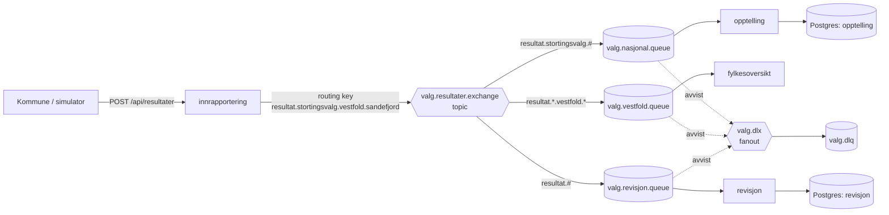

# Valgnatt-motoren – en steg-for-steg tutorial

**Kotlin · Spring Boot · PostgreSQL · RabbitMQ · Docker**

Denne tutorialen tar deg fra en tom mappe til fire samarbeidende mikrotjenester som kjører i Docker. Den er skrevet for å kunne følges *slavisk*: hvert steg forteller nøyaktig hvilke filer du skal lage, hva de skal inneholde, hvilke kommandoer du skal kjøre, og hva du skal se når det virker. Underveis forklares *hvorfor* ting gjøres slik de gjøres.

Prosjektidéen er hentet fra [gemini-project-suggestion.md](gemini-project-suggestion.md): en tjeneste som tar imot valgresultater fra valgkretser på valgnatten og distribuerer dem til flere konsumenter via RabbitMQ.

---

## Innhold

- [Del 0 – Oversikt](#del-0--oversikt)
- [Steg 1 – Verktøy og forutsetninger](#steg-1--verktøy-og-forutsetninger)
- [Steg 2 – Repo-struktur og Git](#steg-2--repo-struktur-og-git)
- [Steg 3 – Infrastruktur: PostgreSQL og RabbitMQ i Docker](#steg-3--infrastruktur-postgresql-og-rabbitmq-i-docker)
- [Steg 4 – Generer `innrapportering`-tjenesten](#steg-4--generer-innrapportering-tjenesten)
- [Steg 5 – Domenemodell og REST-endepunkt](#steg-5--domenemodell-og-rest-endepunkt)
- [Steg 6 – Publiser til en Topic Exchange](#steg-6--publiser-til-en-topic-exchange)
- [Steg 7 – Generer `opptelling`-tjenesten og databasen](#steg-7--generer-opptelling-tjenesten-og-databasen)
- [Steg 8 – Kø, binding, DLQ og idempotent konsument](#steg-8--kø-binding-dlq-og-idempotent-konsument)
- [Steg 9 – Mandatfordeling og REST-API for resultater](#steg-9--mandatfordeling-og-rest-api-for-resultater)
- [Steg 10 – Integrasjonstest med Testcontainers](#steg-10--integrasjonstest-med-testcontainers)
- [Steg 11 – `fylkesoversikt`-tjenesten (wildcard-binding)](#steg-11--fylkesoversikt-tjenesten-wildcard-binding)
- [Steg 12 – `revisjon`-tjenesten (uforanderlig logg)](#steg-12--revisjon-tjenesten-uforanderlig-logg)
- [Steg 13 – Valgnatt-simulator og prioritetskø](#steg-13--valgnatt-simulator-og-prioritetskø)
- [Steg 14 – Alt i Docker](#steg-14--alt-i-docker)
- [Steg 15 – Ende-til-ende-verifisering](#steg-15--ende-til-ende-verifisering)
- [Steg 16 – Videre arbeid](#steg-16--videre-arbeid)
- [Vedlegg A – Feilsøking](#vedlegg-a--feilsøking)
- [Vedlegg B – Ordliste](#vedlegg-b--ordliste)
- [Vedlegg C – Kommandoreferanse](#vedlegg-c--kommandoreferanse)

---

## Del 0 – Oversikt

### Hva vi bygger

Fire Spring Boot-tjenester, hver som et eget delprosjekt i ett felles Gradle-bygg og i sin egen Docker-container:

| Tjeneste | Port | Rolle | Database | RabbitMQ |
|---|---|---|---|---|
| `innrapportering` | 8081 | REST-API som tar imot resultater fra valgkretser + simulator | – | **Produsent** |
| `opptelling` | 8082 | Nasjonal opptelling og mandatfordeling | `opptelling` (JPA + Flyway) | Konsument, binding `resultat.stortingsvalg.#` |
| `fylkesoversikt` | 8083 | Lokal oversikt for ett fylke, «varsler lokalavisene» | – (i minnet) | Konsument, binding `resultat.*.vestfold.*` |
| `revisjon` | 8084 | Uforanderlig logg over alt som er mottatt | `revisjon` (JdbcClient + Flyway) | Konsument, binding `resultat.#` |



### Hva du lærer

- **Kotlin:** data classes, null-sikkerhet, `companion object`/`const val`, lambdaer, collection-API (`associate`, `groupBy`, `map`), string templates, annotasjonsmål (`@field:`).
- **Spring Boot:** prosjektgenerering, auto-konfigurasjon, dependency injection via konstruktør, `@Configuration`/`@Bean`, REST-kontrollere, validering, `application.yml`, profiler/properties, `@Scheduled`, Actuator.
- **Database:** PostgreSQL, Flyway-migreringer, Spring Data JPA (entiteter, repositories, JPQL-aggregering), `JdbcClient`, transaksjoner, database-triggere.
- **RabbitMQ:** exchanges, køer, bindings, routing keys, wildcards (`*` og `#`), ack/reject, dead letter exchange/queue, holdbare køer og persistente meldinger, prioritetskø, prefetch.
- **Arkitektur:** idempotens, «at-least-once»-levering, database-per-tjeneste, egen kopi av meldingskontrakt per tjeneste.
- **Docker:** Docker Compose, multi-stage Dockerfile, healthchecks, volumer, nettverk mellom containere, compose-profiler.
- **Testing:** enhetstester i Kotlin, integrasjonstester med Testcontainers.

### Versjoner tutorialen er skrevet for

| Verktøy | Versjon |
|---|---|
| Java (JDK) | 25 |
| Kotlin | 2.3.x (settes av Spring Initializr) |
| Spring Boot | 4.1.x (siste stabile fra Spring Initializr) |
| Gradle | 9.x via wrapper fra Spring Initializr (Kotlin DSL) |
| Testcontainers | 2.x (settes av Spring Boot) |

> **Verifisert:** All kode i tutorialen er kompilert og kjørt mot Spring Boot 4.1.2 / Kotlin 2.3.21 (17.11.2026): enhets- og integrasjonstester er grønne, og hele systemet er kjørt i Docker med idempotens, DLQ, uforanderlig revisjonslogg og persistens ved restart av RabbitMQ.
| PostgreSQL | 18 (Docker-image `postgres:18-alpine`) |
| RabbitMQ | 4.x (Docker-image `rabbitmq:4-management`) |

> **Merk om Spring Boot-versjon:** Hvis Initializr gir deg Spring Boot **3.x** i stedet for 4.x, er det én ting du må endre: bruk `Jackson2JsonMessageConverter` der tutorialen skriver `JacksonJsonMessageConverter` (se [Vedlegg A](#vedlegg-a--feilsøking)).

### Slik bruker du tutorialen

- Hvert steg avsluttes med **✅ Sjekkpunkt**. Ikke gå videre før sjekkpunktet er oppfylt.
- Hvert steg avsluttes også med en `git commit`. Da kan du alltid gå tilbake til siste fungerende tilstand.
- **💡 Kotlin-hjørnet** og **🐇 RabbitMQ-hjørnet** forklarer konsepter du møter i koden.
- Alle kommandoer kjøres fra **rotmappen** (`valgdirektoratet-vote-counting/`) med mindre noe annet står.

---

## Steg 1 – Verktøy og forutsetninger

### 1.1 Installer verktøy (macOS)

```bash
# Homebrew (hopp over om du har det)
/bin/bash -c "$(curl -fsSL https://raw.githubusercontent.com/Homebrew/install/HEAD/install.sh)"

# JDK 25 (Eclipse Temurin)
brew install --cask temurin@25

# Docker: Docker Desktop ELLER OrbStack (velg én – hopp over om du har en av dem)
brew install --cask docker      # Docker Desktop
# brew install --cask orbstack  # OrbStack (lettere alternativ på Mac)

# Nyttige verktøy
brew install jq httpie
```

Installer også **IntelliJ IDEA** (Community holder, Ultimate er bedre for Spring): `brew install --cask intellij-idea-ce`.

Start Docker Desktop (eller OrbStack) og vent til den er klar.

> **Bruker du OrbStack?** Testcontainers (steg 10) leter etter Docker på `/var/run/docker.sock`. Hvis du har hatt Docker Desktop installert tidligere, kan den fila peke til en Docker Desktop-socket som ikke finnes lenger, og testene feiler med `Could not find a valid Docker environment`. Fiks det én gang for alle:
>
> ```bash
> echo "docker.host=unix://$HOME/.orbstack/run/docker.sock" >> ~/.testcontainers.properties
> ```

### 1.2 Verifiser

```bash
java -version            # skal vise 25.x
docker version           # skal vise både Client og Server
docker compose version   # skal vise v2.x
curl --version
jq --version
```

Hvis `java -version` viser en annen versjon, sett `JAVA_HOME`:

```bash
echo 'export JAVA_HOME=$(/usr/libexec/java_home -v 25)' >> ~/.zshrc
source ~/.zshrc
```

**✅ Sjekkpunkt:** Alle kommandoene over svarer uten feil, og Java er versjon 25.

---

## Steg 2 – Repo-struktur og Git

Vi lar alle tjenestene bo i ett Git-repo («monorepo») og ett **Gradle-multiprosjekt**. Rotmappen har én `settings.gradle.kts` som lister tjenestene, og én Gradle-wrapper som alle deler. Hver tjeneste er et *delprosjekt* med sin egen `build.gradle.kts`, sine egne avhengigheter og sin egen kjørbare jar.

Du velger selv hva som bygges og kjøres ved å sette tjenestenavnet foran tasken: `./gradlew :opptelling:bootRun` starter bare `opptelling`, mens `./gradlew build` bygger alt. Tjenestene deployes fortsatt hver for seg, i hver sin container.

Sluttresultatet vil se slik ut:

```
valgdirektoratet-vote-counting/
├── settings.gradle.kts   ← lister delprosjektene (tjenestene)
├── build.gradle.kts      ← felles plugin-versjoner (steg 4)
├── gradlew, gradle/      ← Gradle-wrapper, felles for alle tjenestene
├── Dockerfile            ← felles for alle tjenestene (steg 14)
├── docker-compose.yml
├── infra/
│   └── postgres/init/01-databaser.sql
├── innrapportering/      ← Spring Boot-prosjekt
├── opptelling/           ← Spring Boot-prosjekt
├── fylkesoversikt/       ← Spring Boot-prosjekt
├── revisjon/             ← Spring Boot-prosjekt
└── docs/
    ├── gemini-project-suggestion.md
    └── tutorial.md
```

```bash
cd ~/code/2026/valgdirektoratet-vote-counting
git init
mkdir -p infra/postgres/init
echo 'rootProject.name = "valgdirektoratet-vote-counting"' > settings.gradle.kts
```

`settings.gradle.kts` forteller Gradle hvilke delprosjekter bygget består av. Foreløpig er det tomt; vi legger til én `include(...)`-linje hver gang vi lager en tjeneste.

Lag `.gitignore` i rotmappen:

```gitignore
.DS_Store
.idea/
*.iml
build/
.gradle/
.kotlin/
bin/
HELP.md
!gradle/wrapper/gradle-wrapper.jar
```

Rotens `.gitignore` gjelder for alle undermapper, så den dekker byggemappene til alle tjenestene. `HELP.md` er en fil Initializr legger i hvert prosjekt; den trenger vi ikke.

```bash
git add .
git commit -m "Initielt repo med dokumentasjon"
```

**✅ Sjekkpunkt:** `git log` viser én commit.

---

## Steg 3 – Infrastruktur: PostgreSQL og RabbitMQ i Docker

Før vi skriver kode, starter vi infrastrukturen. Da kan vi kjøre tjenestene fra IntelliJ/Gradle mot ekte Postgres og RabbitMQ allerede fra start.

### 3.1 Databaser per tjeneste

Et viktig mikrotjenesteprinsipp er **database per tjeneste**: ingen tjeneste leser en annen tjenestes tabeller. Vi kjører én Postgres-container (for å spare ressurser), men lager én *database* per tjeneste.

Lag `infra/postgres/init/01-databaser.sql`:

```sql
-- Kjøres automatisk av Postgres-containeren FØRSTE gang den starter
-- (dvs. når datavolumet er tomt).
CREATE DATABASE opptelling OWNER valg;
CREATE DATABASE revisjon OWNER valg;
```

### 3.2 Sjekk at portene er ledige

Har du andre prosjekter med Postgres eller RabbitMQ kjørende, kolliderer portene:

```bash
for p in 5432 5672 15672; do lsof -nP -iTCP:$p -sTCP:LISTEN >/dev/null && echo "$p OPPTATT" || echo "$p ledig"; done
docker ps   # hvilke containere kjører nå?
```

Er 5432 opptatt, stopp den andre databasen mens du jobber med tutorialen, eller bytt til `"5433:5432"` i compose-fila under **og** `localhost:5433` i `application.yml` for `opptelling` og `revisjon`. (Inne i Docker-nettverket i steg 14 brukes alltid 5432, så det påvirkes ikke.)

### 3.3 docker-compose.yml

Lag `docker-compose.yml` i rotmappen:

```yaml
services:
  postgres:
    image: postgres:18-alpine
    container_name: valg-postgres
    environment:
      POSTGRES_USER: valg
      POSTGRES_PASSWORD: valg
      POSTGRES_DB: valg
    ports:
      - "5432:5432"
    volumes:
      - postgres-data:/var/lib/postgresql   # Postgres 18+: IKKE /var/lib/postgresql/data
      - ./infra/postgres/init:/docker-entrypoint-initdb.d:ro
    healthcheck:
      test: ["CMD-SHELL", "pg_isready -U valg -d valg"]
      interval: 5s
      timeout: 5s
      retries: 10

  rabbitmq:
    image: rabbitmq:4-management
    container_name: valg-rabbitmq
    hostname: rabbitmq          # RabbitMQ lagrer data under nodenavnet – hold det fast
    environment:
      RABBITMQ_DEFAULT_USER: valg
      RABBITMQ_DEFAULT_PASS: valg
    ports:
      - "5672:5672"     # AMQP – applikasjonene
      - "15672:15672"   # Web-grensesnitt
    volumes:
      - rabbitmq-data:/var/lib/rabbitmq
    healthcheck:
      test: ["CMD", "rabbitmq-diagnostics", "-q", "ping"]
      interval: 10s
      timeout: 10s
      retries: 10

volumes:
  postgres-data:
  rabbitmq-data:
```

**Forklaring:**

- `volumes` (navngitte volumer) gjør at data overlever `docker compose down`. Bare `docker compose down -v` sletter dem.
- `postgres-data:/var/lib/postgresql` – fra Postgres 18 lagrer imaget dataene i en versjonsspesifikk undermappe (`/var/lib/postgresql/18/docker`). Volumet monteres derfor på `/var/lib/postgresql`, ikke på `/var/lib/postgresql/data` som i eldre versjoner. Monterer du på den gamle stien, nekter containeren å starte. Fordelen er at en senere oppgradering til 19 får sin egen mappe ved siden av i samme volum.
- `./infra/postgres/init:/docker-entrypoint-initdb.d:ro` – en *bind mount* som gjør mappen `infra/postgres/init` på maskinen din synlig inne i containeren, skrivebeskyttet (`ro`). Første gang containeren starter med et tomt datavolum, kjører Postgres alle `.sql`- og `.sh`-filer i mappen i alfabetisk rekkefølge. Senere endringer i filene kjøres ikke før volumet er slettet.
- De navngitte volumene ligger inne i Dockers Linux-VM, ikke som vanlige mapper på Mac-en. Compose setter prosjektnavnet foran, så de heter f.eks. `<mappenavn>_postgres-data`. Se dem med `docker volume ls`.
- `rabbitmq:4-management` inkluderer web-grensesnittet på port 15672.
- `healthcheck` lar oss senere si «ikke start appene før databasen og RabbitMQ er klare».

### 3.4 Start og verifiser

```bash
docker compose up -d
docker compose ps
```

Vent til begge viser `healthy` (kjør `docker compose ps` igjen etter ~20 sek).

Sjekk databasene:

```bash
docker compose exec postgres psql -U valg -d valg -c '\l'
```

Du skal se `opptelling`, `revisjon` og `valg` i listen.

Sjekk RabbitMQ: åpne <http://localhost:15672> og logg inn med `valg` / `valg`. Se på fanene **Exchanges** og **Queues** – foreløpig finnes bare standard-exchangene (`amq.*`).

```bash
git add .
git commit -m "Infrastruktur: Postgres og RabbitMQ i Docker Compose"
```

**✅ Sjekkpunkt:** Begge containere er `healthy`, databasene finnes, og du er logget inn i RabbitMQ-grensesnittet.

---

## Steg 4 – Generer `innrapportering`-tjenesten

### 4.1 Generer prosjektet med Spring Initializr

Vi bruker Initializr fra kommandolinjen, slik at resultatet blir helt reproduserbart:

```bash
curl -s https://start.spring.io/starter.zip \
  -d type=gradle-project-kotlin \
  -d language=kotlin \
  -d javaVersion=25 \
  -d groupId=no.valg \
  -d artifactId=innrapportering \
  -d name=innrapportering \
  -d packageName=no.valg.innrapportering \
  -d baseDir=innrapportering \
  -d dependencies=web,rabbitmq,validation,actuator \
  -o innrapportering.zip

unzip innrapportering.zip && rm innrapportering.zip
```

(Du kan også bruke <https://start.spring.io> i nettleseren med de samme valgene.)

Initializr lager alltid et *selvstendig* prosjekt, med egen wrapper og egen `settings.gradle.kts`. Vi gjør det om til et delprosjekt. Siden dette er den første tjenesten, flytter vi wrapperen opp til rotmappen, der alle tjenestene skal dele den:

```bash
# Flytt Gradle-wrapperen til rotmappen
mv innrapportering/gradlew innrapportering/gradlew.bat innrapportering/gradle innrapportering/.gitattributes .
# Fjern det som gjorde innrapportering til et eget prosjekt
rm innrapportering/settings.gradle.kts innrapportering/.gitignore innrapportering/HELP.md
# Ta med tjenesten i bygget
echo 'include("innrapportering")' >> settings.gradle.kts
```

For de neste tjenestene sletter vi wrapperen i stedet for å flytte den, siden rotmappen allerede har en.

**Felles plugin-versjoner.** Initializr skriver versjonen på hver plugin i `plugins { ... }`, for eksempel `kotlin("jvm") version "2.3.21"`. Hvis flere delprosjekter gjør det, laster Gradle Kotlin-pluginen én gang per tjeneste, og fra tredje tjeneste advarer Kotlin om at *«The Kotlin Gradle plugin was loaded multiple times in different subprojects»*. Løsningen er å sette versjonene ett sted, i en `build.gradle.kts` i rotmappen:

```kotlin
plugins {
    // Versjonene for tjenestenes plugins settes her, én gang for alle.
    // `apply false` betyr at roten selv ikke bruker dem; tjenestene tar dem i bruk uten versjon.
    kotlin("jvm") version "2.3.21" apply false
    kotlin("plugin.spring") version "2.3.21" apply false
    kotlin("plugin.jpa") version "2.3.21" apply false
    id("org.springframework.boot") version "4.1.2" apply false
    id("io.spring.dependency-management") version "1.1.7" apply false
}
```

Bruk versjonene fra `innrapportering/build.gradle.kts` hvis Initializr ga deg nyere. `plugin.jpa` trenger vi først i steg 7, men den skal ha samme versjon som de andre Kotlin-pluginene.

Fjern så versjonene fra tjenestens `plugins`-blokk:

```bash
sed -i '' -E 's/\) version "[^"]+"/)/' innrapportering/build.gradle.kts
```

`plugins`-blokken i `innrapportering/build.gradle.kts` skal nå se slik ut:

```kotlin
plugins {
    kotlin("jvm")
    kotlin("plugin.spring")
    id("org.springframework.boot")
    id("io.spring.dependency-management")
}
```

En fordel er at du oppgraderer Kotlin eller Spring Boot for alle tjenestene ved å endre én linje i rotens `build.gradle.kts`.

| Avhengighet | Hva den gir |
|---|---|
| `web` | Spring MVC + innebygd Tomcat for REST-API (`spring-boot-starter-webmvc`) |
| `rabbitmq` | Spring AMQP / RabbitMQ-klient (`spring-boot-starter-amqp`) |
| `validation` | Bean Validation (`@NotBlank` osv.) |
| `actuator` | Helse- og driftsendepunkter (`/actuator/health`) |

### 4.2 Bli kjent med det genererte prosjektet

Åpne **rotmappen** `valgdirektoratet-vote-counting/` i IntelliJ (**File → Open** → velg mappen → «Trust project»). Vent til Gradle-synkroniseringen er ferdig. IntelliJ leser `settings.gradle.kts` og viser hver tjeneste som en modul; nye tjenester dukker opp når du laster Gradle-prosjektet på nytt (**Gradle-vinduet → Reload All Gradle Projects**).

```
valgdirektoratet-vote-counting/
├── settings.gradle.kts            ← rootProject.name + include("innrapportering")
├── build.gradle.kts               ← plugin-versjoner for alle tjenestene
├── gradlew / gradlew.bat          ← Gradle-wrapper (ingen global Gradle nødvendig)
├── gradle/wrapper/                ← hvilken Gradle-versjon wrapperen laster ned
└── innrapportering/
    ├── build.gradle.kts           ← byggescript for tjenesten (Kotlin DSL)
    └── src/
        ├── main/kotlin/no/valg/innrapportering/InnrapporteringApplication.kt
        ├── main/resources/application.properties
        └── test/kotlin/no/valg/innrapportering/InnrapporteringApplicationTests.kt
```

Les gjennom `build.gradle.kts`. Viktige deler:

- `plugins { ... }` – hvilke Gradle-plugins tjenesten bruker. Versjonene står i rotens `build.gradle.kts`.
- `kotlin("plugin.spring")` – gjør klasser med Spring-annotasjoner `open`. Kotlin-klasser er `final` som standard, men Spring må kunne lage subklasser (proxyer) av f.eks. `@Configuration`- og `@Transactional`-klasser.
- `java { toolchain { languageVersion = JavaLanguageVersion.of(25) } }` – bygger med JDK 25. Er ikke JDK 25 installert, feiler bygget.
- `kotlin { compilerOptions { freeCompilerArgs.addAll("-Xjsr305=strict", ...) } }` – gjør at Kotlin respekterer Springs `@Nullable`-annotasjoner, slik at null-sikkerhet også gjelder Spring-API-er.
- `jackson-module-kotlin` – lar Jackson lage Kotlin data classes fra JSON.

**Legg til** nederst i `build.gradle.kts` (vi trenger dette for Docker i steg 14):

```kotlin
// Ikke lag den ekstra "-plain.jar"-fila; vi vil bare ha én kjørbar jar.
tasks.named<Jar>("jar") {
    enabled = false
}
```

### 4.3 Bytt til application.yml

Slett `src/main/resources/application.properties` og lag `src/main/resources/application.yml`:

```yaml
server:
  port: 8081

spring:
  application:
    name: innrapportering
  rabbitmq:
    host: localhost
    port: 5672
    username: valg
    password: valg

management:
  endpoints:
    web:
      exposure:
        include: health,info
  endpoint:
    health:
      show-details: always
```

YAML og `.properties` er likeverdige; YAML er lettere å lese når konfigurasjonen er nøstet.

### 4.4 Kjør

Alle Gradle-kommandoer i tutorialen kjøres fra **rotmappen**:

```bash
./gradlew :innrapportering:bootRun
```

`:innrapportering:bootRun` betyr «tasken `bootRun` i delprosjektet `innrapportering`». Uten prefikset (`./gradlew bootRun`) kjører Gradle `bootRun` i *alle* tjenestene.

I en annen terminal:

```bash
curl -s localhost:8081/actuator/health | jq
```

Du skal se `"status": "UP"` og en `rabbit`-komponent som også er `UP`. Det betyr at Spring Boot automatisk har konfigurert en tilkobling til RabbitMQ basert på `spring.rabbitmq.*`-propertiene – det er **auto-konfigurasjon** i praksis.

Stopp appen med `Ctrl+C`. Gradle melder da `BUILD FAILED` / «Build cancelled» – det er forventet, siden `bootRun` aldri blir ferdig av seg selv.

```bash
git add .
git commit -m "innrapportering: generert prosjekt"
```

**✅ Sjekkpunkt:** `/actuator/health` svarer `UP`, inkludert `rabbit`.

---

## Steg 5 – Domenemodell og REST-endepunkt

Alle filer i dette steget legges i `innrapportering/src/main/kotlin/no/valg/innrapportering/`.

### 5.1 Meldingen

Lag `ValgresultatMelding.kt`:

```kotlin
package no.valg.innrapportering

import jakarta.validation.constraints.NotBlank
import jakarta.validation.constraints.NotEmpty

/**
 * Et opptalt resultat fra én valgkrets.
 *
 * meldingId settes av avsender (kommunens system). Hvis avsender sender samme
 * resultat på nytt (f.eks. etter nettverksfeil), skal meldingId være den samme,
 * slik at mottakerne kan oppdage duplikatet.
 */
data class ValgresultatMelding(
    @field:NotBlank val meldingId: String,
    @field:NotBlank val valgType: String,   // "STORTINGSVALG" eller "KOMMUNEVALG"
    @field:NotBlank val fylke: String,      // "Vestfold"
    @field:NotBlank val kommune: String,    // "Sandefjord"
    @field:NotBlank val krets: String,      // "Stokke"
    @field:NotEmpty val stemmerPerParti: Map<String, Int>,
    val erEndelig: Boolean = false,         // foreløpig telling vs. endelig godkjent
)
```

> **💡 Kotlin-hjørnet: data class og `@field:`**
>
> - `data class` gir deg automatisk `equals`, `hashCode`, `toString` og `copy` basert på feltene i konstruktøren. Perfekt for meldinger og DTO-er.
> - `val` betyr skrivebeskyttet (immutable). Bruk `val` som standard.
> - `String` (uten `?`) kan aldri være `null`. Prøver noen å sende JSON uten `meldingId`, feiler deserialiseringen før koden din kjører.
> - `= false` er en standardverdi; feltet kan utelates i JSON.
> - `@field:NotBlank`: En Kotlin-`val` i konstruktøren blir *både* en konstruktørparameter, et felt og en getter. `@field:` sier eksplisitt at annotasjonen skal på **feltet**, som er der Bean Validation leter.

> **Bevisst valg:** Vi validerer ikke at stemmetall er ikke-negative her. I virkeligheten ville du gjort det, men vi vil at korrupte data skal slippe gjennom til konsumentene, slik at vi kan se Dead Letter Queue i aksjon i steg 8.

### 5.2 Kontrolleren (første versjon)

Lag `ResultatController.kt`:

```kotlin
package no.valg.innrapportering

import jakarta.validation.Valid
import org.slf4j.LoggerFactory
import org.springframework.http.ResponseEntity
import org.springframework.web.bind.annotation.PostMapping
import org.springframework.web.bind.annotation.RequestBody
import org.springframework.web.bind.annotation.RequestMapping
import org.springframework.web.bind.annotation.RestController

@RestController
@RequestMapping("/api/resultater")
class ResultatController {

    private val log = LoggerFactory.getLogger(javaClass)

    @PostMapping
    fun motta(@Valid @RequestBody melding: ValgresultatMelding): ResponseEntity<Map<String, String>> {
        log.info("Mottok {}", melding)
        return ResponseEntity.accepted().body(mapOf("meldingId" to melding.meldingId))
    }
}
```

- `@RestController` = kontroller der returverdien serialiseres til JSON.
- `@Valid` trigger valideringen fra 5.1. Feiler den, svarer Spring automatisk `400 Bad Request`.
- Vi svarer `202 Accepted`: «vi har tatt imot meldingen og vil behandle den» – ikke «den er ferdig behandlet». Det er riktig semantikk for asynkrone systemer.

> **💡 Kotlin-hjørnet:** `mapOf("a" to "b")` lager en uforanderlig `Map`. `to` er en *infix-funksjon* som lager et `Pair`.

### 5.3 Test

```bash
./gradlew :innrapportering:bootRun
```

I en annen terminal:

```bash
# Gyldig melding → 202
curl -i -X POST localhost:8081/api/resultater \
  -H 'Content-Type: application/json' \
  -d '{
    "meldingId": "stokke-001",
    "valgType": "STORTINGSVALG",
    "fylke": "Vestfold",
    "kommune": "Sandefjord",
    "krets": "Stokke",
    "stemmerPerParti": {"AP": 1200, "H": 1100, "FRP": 800},
    "erEndelig": false
  }'

# Mangler krets (tom streng) → 400
curl -i -X POST localhost:8081/api/resultater \
  -H 'Content-Type: application/json' \
  -d '{"meldingId":"x","valgType":"STORTINGSVALG","fylke":"Vestfold","kommune":"Sandefjord","krets":"","stemmerPerParti":{"AP":1}}'
```

```bash
git add . && git commit -m "innrapportering: REST-endepunkt med validering"
```

**✅ Sjekkpunkt:** Første kall gir `202` og logglinje i appen. Andre kall gir `400`.

---

## Steg 6 – Publiser til en Topic Exchange

> **🐇 RabbitMQ-hjørnet: Grunnbegreper**
>
> - En **produsent** sender aldri direkte til en kø. Den sender til en **exchange** sammen med en **routing key**.
> - En **kø** lagrer meldinger til en **konsument** henter dem.
> - En **binding** kobler en kø til en exchange med et **mønster**.
> - En **topic exchange** sammenligner routing key med mønstrene. Routing key består av ord separert med punktum: `resultat.stortingsvalg.vestfold.sandefjord`.
>   - `*` matcher **nøyaktig ett** ord. `resultat.*.vestfold.*` matcher `resultat.kommunevalg.vestfold.tønsberg`.
>   - `#` matcher **null eller flere** ord. `resultat.#` matcher alt som begynner med `resultat`.
> - Matcher ingen binding, **forkastes meldingen stille**. Det skal vi se med egne øyne.

### 6.1 RabbitMQ-konfigurasjon

Lag `RabbitConfig.kt`:

```kotlin
package no.valg.innrapportering

import org.springframework.amqp.core.TopicExchange
import org.springframework.amqp.support.converter.JacksonJsonMessageConverter
import org.springframework.amqp.support.converter.MessageConverter
import org.springframework.context.annotation.Bean
import org.springframework.context.annotation.Configuration

@Configuration
class RabbitConfig {

    companion object {
        const val RESULTAT_EXCHANGE = "valg.resultater.exchange"
    }

    /** Spring Boot deklarerer denne i RabbitMQ automatisk (durable = true som standard). */
    @Bean
    fun resultatExchange(): TopicExchange = TopicExchange(RESULTAT_EXCHANGE)

    /** Send meldinger som JSON i stedet for serialiserte Java-objekter. */
    @Bean
    fun messageConverter(): MessageConverter = JacksonJsonMessageConverter()
}
```

- En `@Bean`-metode returnerer et objekt som Spring skal administrere. Spring Boot oppdager `Exchange`-, `Queue`- og `Binding`-bønner og **deklarerer dem i RabbitMQ** (via en `RabbitAdmin`) første gang appen kobler seg til.
- Når det finnes en `MessageConverter`-bønne, bruker Spring Boots auto-konfigurerte `RabbitTemplate` den automatisk.

> **💡 Kotlin-hjørnet: `companion object` og `const val`**
>
> Kotlin har ikke `static`. Et `companion object` er et objekt knyttet til klassen, og `const val` er en kompileringstidskonstant. Vi trenger `const` fordi annotasjoner (som `@RabbitListener(queues = [...])` senere) bare godtar konstanter.

### 6.2 Routing key

Lag `RoutingKey.kt`:

```kotlin
package no.valg.innrapportering

/**
 * Bygger routing key på formen resultat.<valgtype>.<fylke>.<kommune>,
 * f.eks. "resultat.stortingsvalg.vestfold.sandefjord".
 */
fun routingKeyFor(melding: ValgresultatMelding): String =
    listOf("resultat", melding.valgType, melding.fylke, melding.kommune)
        .joinToString(separator = ".") { normaliser(it) }

/** Små bokstaver, og ingen punktum/mellomrom inne i et ord (punktum er ordskille i routing keys). */
private fun normaliser(del: String): String =
    del.trim().lowercase().replace(Regex("[\\s.]+"), "-")
```

> **💡 Kotlin-hjørnet:** Funksjoner trenger ikke ligge i en klasse – dette er *top-level-funksjoner*. `private` på top-level betyr «synlig bare i denne fila». `joinToString { ... }` tar en lambda som transformerer hvert element; `it` er det implisitte navnet på lambda-parameteren.

### 6.3 Publisher-tjenesten

Lag `ResultatPublisher.kt`:

```kotlin
package no.valg.innrapportering

import org.slf4j.LoggerFactory
import org.springframework.amqp.core.MessagePostProcessor
import org.springframework.amqp.rabbit.core.RabbitTemplate
import org.springframework.stereotype.Service

@Service
class ResultatPublisher(private val rabbitTemplate: RabbitTemplate) {

    private val log = LoggerFactory.getLogger(javaClass)

    fun publiser(melding: ValgresultatMelding): String {
        val routingKey = routingKeyFor(melding)

        rabbitTemplate.convertAndSend(
            RabbitConfig.RESULTAT_EXCHANGE,
            routingKey,
            melding,
            MessagePostProcessor { amqpMelding ->
                amqpMelding.messageProperties.messageId = melding.meldingId
                // Brukes av prioritetskøen i steg 13. Høyere tall = høyere prioritet.
                amqpMelding.messageProperties.priority = if (melding.erEndelig) 10 else 1
                amqpMelding
            },
        )

        log.info("Publiserte {} med routing key {}", melding.meldingId, routingKey)
        return routingKey
    }
}
```

- **Konstruktør-injeksjon:** Spring ser at `ResultatPublisher` trenger en `RabbitTemplate` og gir den en. Ingen `@Autowired` nødvendig.
- `convertAndSend` bruker `MessageConverter`-en vår til å gjøre `melding` om til JSON.
- `MessagePostProcessor` lar oss endre AMQP-meldingens metadata (headers/properties) før sending.
- Meldinger sendes som **persistente** (`deliveryMode = PERSISTENT`) som standard i Spring AMQP – de skrives til disk i durable køer og overlever en restart av RabbitMQ.

### 6.4 Koble kontrolleren til publisheren

Erstatt innholdet i `ResultatController.kt`:

```kotlin
package no.valg.innrapportering

import jakarta.validation.Valid
import org.springframework.http.ResponseEntity
import org.springframework.web.bind.annotation.PostMapping
import org.springframework.web.bind.annotation.RequestBody
import org.springframework.web.bind.annotation.RequestMapping
import org.springframework.web.bind.annotation.RestController

@RestController
@RequestMapping("/api/resultater")
class ResultatController(private val publisher: ResultatPublisher) {

    @PostMapping
    fun motta(@Valid @RequestBody melding: ValgresultatMelding): ResponseEntity<Map<String, String>> {
        val routingKey = publisher.publiser(melding)
        return ResponseEntity.accepted().body(
            mapOf("meldingId" to melding.meldingId, "routingKey" to routingKey),
        )
    }
}
```

### 6.5 Se at meldinger forsvinner – og fang dem

Start appen og send meldingen fra 5.3 på nytt. Svaret inneholder nå `routingKey`.

Gå til RabbitMQ-grensesnittet → **Exchanges**. `valg.resultater.exchange` finnes nå (type `topic`). Men meldingen havnet ingen steder, fordi ingen kø er bundet til exchangen. **Den er borte.**

La oss fange meldingene manuelt:

1. **Queues and Streams → Add a new queue**: navn `debug.alt`, type *Classic*, durable. Klikk **Add queue**.
2. Klikk på `debug.alt` → **Bindings** → *From exchange*: `valg.resultater.exchange`, *Routing key*: `resultat.#` → **Bind**.
3. Send meldingen med curl én gang til.
4. I `debug.alt` → **Get messages** → **Get Message(s)**. Du ser JSON-en, headere som `__TypeId__`, `priority` og `message_id`, og routing key.

Prøv gjerne å endre bindingen til `resultat.kommunevalg.#` og se at stortingsvalg-meldinger *ikke* kommer fram.

Slett køen `debug.alt` når du er ferdig (**Delete / purge → Delete Queue**).

```bash
git add . && git commit -m "innrapportering: publiserer til topic exchange"
```

**✅ Sjekkpunkt:** Du har sett en melding i `debug.alt` med riktig routing key og JSON-innhold.

---

## Steg 7 – Generer `opptelling`-tjenesten og databasen

### 7.1 Generer

Fra rotmappen:

```bash
curl -s https://start.spring.io/starter.zip \
  -d type=gradle-project-kotlin \
  -d language=kotlin \
  -d javaVersion=25 \
  -d groupId=no.valg \
  -d artifactId=opptelling \
  -d name=opptelling \
  -d packageName=no.valg.opptelling \
  -d baseDir=opptelling \
  -d dependencies=web,rabbitmq,data-jpa,postgresql,flyway,actuator,testcontainers \
  -o opptelling.zip

unzip opptelling.zip && rm opptelling.zip

# Gjør opptelling til et delprosjekt: rotmappen har allerede wrapper og settings
rm -r opptelling/gradlew opptelling/gradlew.bat opptelling/gradle opptelling/settings.gradle.kts opptelling/.gitignore opptelling/.gitattributes opptelling/HELP.md
echo 'include("opptelling")' >> settings.gradle.kts
# Plugin-versjonene står i rotens build.gradle.kts
sed -i '' -E 's/\) version "[^"]+"/)/' opptelling/build.gradle.kts
```

Nye avhengigheter:

| Avhengighet | Hva den gir |
|---|---|
| `data-jpa` | Spring Data JPA + Hibernate (ORM) |
| `postgresql` | JDBC-driveren for Postgres |
| `flyway` | Versjonerte databasemigreringer |
| `testcontainers` | Starter ekte Postgres/RabbitMQ i Docker under tester (steg 10) |

Last Gradle-prosjektet på nytt i IntelliJ, så dukker `opptelling` opp som modul. Legg også her til nederst i `opptelling/build.gradle.kts`:

```kotlin
tasks.named<Jar>("jar") {
    enabled = false
}
```

Legg merke til at `build.gradle.kts` nå også har `kotlin("plugin.jpa")` og en `allOpen`-blokk. JPA krever at entiteter har en argumentløs konstruktør og ikke er `final`; disse pluginene ordner det for Kotlin-klasser.

### 7.2 Konfigurasjon

Slett `application.properties` og lag `src/main/resources/application.yml`:

```yaml
server:
  port: 8082

spring:
  application:
    name: opptelling
  datasource:
    url: jdbc:postgresql://localhost:5432/opptelling
    username: valg
    password: valg
  jpa:
    hibernate:
      ddl-auto: validate   # Flyway eier skjemaet; Hibernate skal bare sjekke at det stemmer
    open-in-view: false
  rabbitmq:
    host: localhost
    port: 5672
    username: valg
    password: valg
    listener:
      simple:
        default-requeue-rejected: false   # Feil → ikke tilbake i køen, men til DLQ
        prefetch: 10

management:
  endpoints:
    web:
      exposure:
        include: health,info
  endpoint:
    health:
      show-details: always
```

**Hvorfor `ddl-auto: validate`?** Hibernate *kan* lage tabeller selv (`update`), men det er uforutsigbart i produksjon. Med Flyway skriver vi SQL-en selv, den versjoneres i Git, og den kjøres nøyaktig én gang per database.

### 7.3 Første migrering

Lag `src/main/resources/db/migration/V1__opprett_tabeller.sql`:

```sql
-- Hvilke meldinger er allerede behandlet? (idempotens)
CREATE TABLE behandlet_melding (
    melding_id          VARCHAR(100) PRIMARY KEY,
    behandlet_tidspunkt TIMESTAMPTZ  NOT NULL
);

-- Siste kjente stemmetall per parti per krets
CREATE TABLE parti_stemmer (
    id          BIGSERIAL    PRIMARY KEY,
    valg_type   VARCHAR(50)  NOT NULL,
    fylke       VARCHAR(100) NOT NULL,
    kommune     VARCHAR(100) NOT NULL,
    krets       VARCHAR(100) NOT NULL,
    parti       VARCHAR(50)  NOT NULL,
    stemmer     INT          NOT NULL CHECK (stemmer >= 0),
    er_endelig  BOOLEAN      NOT NULL,
    melding_id  VARCHAR(100) NOT NULL
);

CREATE INDEX idx_parti_stemmer_krets ON parti_stemmer (valg_type, fylke, kommune, krets);
```

Filnavnet er viktig: `V1__` (to understreker) gir versjonsnummeret. Neste endring blir `V2__noe.sql`. **Endre aldri en migrering som allerede er kjørt** – lag en ny.

Legg merke til `CHECK (stemmer >= 0)`: databasen er siste forsvarslinje mot negative stemmetall.

### 7.4 Entiteter

Lag `src/main/kotlin/no/valg/opptelling/BehandletMelding.kt`:

```kotlin
package no.valg.opptelling

import jakarta.persistence.Entity
import jakarta.persistence.Id
import jakarta.persistence.Table
import java.time.Instant

@Entity
@Table(name = "behandlet_melding")
class BehandletMelding(
    @Id
    val meldingId: String,
    val behandletTidspunkt: Instant = Instant.now(),
)
```

Lag `PartiStemmer.kt`:

```kotlin
package no.valg.opptelling

import jakarta.persistence.Entity
import jakarta.persistence.GeneratedValue
import jakarta.persistence.GenerationType
import jakarta.persistence.Id
import jakarta.persistence.Table

@Entity
@Table(name = "parti_stemmer")
class PartiStemmer(
    val valgType: String,
    val fylke: String,
    val kommune: String,
    val krets: String,
    val parti: String,
    val stemmer: Int,
    val erEndelig: Boolean,
    val meldingId: String,

    @Id
    @GeneratedValue(strategy = GenerationType.IDENTITY)
    val id: Long? = null,
)
```

- Spring Boot oversetter automatisk `valgType` → kolonnen `valg_type` (camelCase → snake_case).
- `id: Long? = null`: `null` betyr «ikke lagret ennå»; databasen (`BIGSERIAL`) gir id-en.

> **💡 Kotlin-hjørnet: Hvorfor `class` og ikke `data class` for entiteter?**
>
> JPA-entiteter har identitet (id) og kan ha lazy-lastede relasjoner. En `data class` genererer `equals`/`hashCode`/`toString` fra *alle* feltene, noe som gir subtile feil med Hibernate. Bruk vanlige klasser for entiteter, og `data class` for DTO-er og meldinger.

### 7.5 Repositories

Lag `Repositories.kt`:

```kotlin
package no.valg.opptelling

import org.springframework.data.jpa.repository.JpaRepository
import org.springframework.data.jpa.repository.Query
import org.springframework.data.repository.query.Param

interface BehandletMeldingRepository : JpaRepository<BehandletMelding, String>

interface PartiStemmerRepository : JpaRepository<PartiStemmer, Long> {

    fun findByValgTypeAndFylkeAndKommuneAndKrets(
        valgType: String,
        fylke: String,
        kommune: String,
        krets: String,
    ): List<PartiStemmer>

    @Query(
        """
        SELECT p.parti AS parti, SUM(p.stemmer) AS stemmer
        FROM PartiStemmer p
        WHERE p.valgType = :valgType
        GROUP BY p.parti
        ORDER BY SUM(p.stemmer) DESC
        """,
    )
    fun summerPerParti(@Param("valgType") valgType: String): List<PartiSum>
}

/** Projeksjon: Spring Data lager en implementasjon av dette grensesnittet for hver rad. */
interface PartiSum {
    val parti: String
    val stemmer: Long
}
```

- Du skriver bare grensesnittet; Spring Data lager implementasjonen ved oppstart.
- `findByValgTypeAndFylkeAndKommuneAndKrets` er en **avledet spørring**: Spring Data leser metodenavnet og lager SQL-en.
- `@Query` bruker **JPQL** (spør mot entiteter og felt, ikke tabeller og kolonner).

### 7.6 Kjør og se at Flyway gjør jobben

```bash
./gradlew :opptelling:bootRun
```

I loggen skal du se noe slikt som `Successfully applied 1 migration to schema "public", now at version v1`.

```bash
docker compose exec postgres psql -U valg -d opptelling -c '\dt'
```

Du ser `behandlet_melding`, `parti_stemmer` og `flyway_schema_history`.

```bash
git add . && git commit -m "opptelling: prosjekt, Flyway-skjema og JPA-entiteter"
```

**✅ Sjekkpunkt:** Appen starter uten feil, og tabellene finnes i databasen `opptelling`.

---

## Steg 8 – Kø, binding, DLQ og idempotent konsument

Alle filer i `opptelling/src/main/kotlin/no/valg/opptelling/`.

### 8.1 Tjenestens egen kopi av meldingen

Lag `ValgresultatMelding.kt`:

```kotlin
package no.valg.opptelling

data class ValgresultatMelding(
    val meldingId: String,
    val valgType: String,
    val fylke: String,
    val kommune: String,
    val krets: String,
    val stemmerPerParti: Map<String, Int>,
    val erEndelig: Boolean = false,
)
```

**Hvorfor en kopi og ikke et delt bibliotek?** Et delt «common»-bibliotek binder tjenestene sammen: endrer du det, må alle tjenester bygges og deployes samtidig. Kontrakten mellom tjenestene er **JSON-formatet**, ikke en Kotlin-klasse. Hver konsument tar bare med feltene den trenger (Jackson ignorerer ukjente felt).

> **🐇 RabbitMQ-hjørnet: `__TypeId__`-headeren**
>
> Produsenten la ved headeren `__TypeId__ = no.valg.innrapportering.ValgresultatMelding`. Den klassen finnes ikke i `opptelling`! Det går likevel bra: når en `@RabbitListener`-metode har en konkret parametertype, bruker Spring AMQP *den* typen og ignorerer headeren.

### 8.2 Kø-topologi med Dead Letter Exchange

Lag `RabbitConfig.kt`:

```kotlin
package no.valg.opptelling

import org.springframework.amqp.core.Binding
import org.springframework.amqp.core.BindingBuilder
import org.springframework.amqp.core.FanoutExchange
import org.springframework.amqp.core.Queue
import org.springframework.amqp.core.QueueBuilder
import org.springframework.amqp.core.TopicExchange
import org.springframework.amqp.support.converter.JacksonJsonMessageConverter
import org.springframework.amqp.support.converter.MessageConverter
import org.springframework.context.annotation.Bean
import org.springframework.context.annotation.Configuration

@Configuration
class RabbitConfig {

    companion object {
        const val RESULTAT_EXCHANGE = "valg.resultater.exchange"
        const val DLX = "valg.dlx"
        const val DLQ = "valg.dlq"
        const val QUEUE = "valg.nasjonal.queue"
        const val BINDING = "resultat.stortingsvalg.#"
    }

    // Samme exchange som produsenten. Å deklarere den på nytt er trygt (idempotent),
    // og gjør at konsumenten kan starte før produsenten.
    @Bean
    fun resultatExchange() = TopicExchange(RESULTAT_EXCHANGE)

    // --- Dead letter-oppsett ---
    @Bean
    fun deadLetterExchange() = FanoutExchange(DLX)

    @Bean
    fun deadLetterQueue(): Queue = QueueBuilder.durable(DLQ).build()

    @Bean
    fun deadLetterBinding(): Binding = BindingBuilder.bind(deadLetterQueue()).to(deadLetterExchange())

    // --- Hovedkøen ---
    @Bean
    fun nasjonalQueue(): Queue =
        QueueBuilder.durable(QUEUE)
            .deadLetterExchange(DLX)   // x-dead-letter-exchange
            .maxPriority(10)           // x-max-priority (brukes i steg 13)
            .build()

    @Bean
    fun nasjonalBinding(): Binding =
        BindingBuilder.bind(nasjonalQueue()).to(resultatExchange()).with(BINDING)

    @Bean
    fun messageConverter(): MessageConverter = JacksonJsonMessageConverter()
}
```

> **🐇 RabbitMQ-hjørnet: Ack, reject og dead lettering**
>
> - Når konsumenten har behandlet en melding, sender den **ack** og RabbitMQ sletter meldingen.
> - Kaster lytter-metoden et unntak, sender Spring en **reject**. Med `default-requeue-rejected: false` (satt i 7.2) legges meldingen *ikke* tilbake i køen – ellers ville en korrupt melding blitt levert om og om igjen i en evig løkke («poison message»).
> - Fordi køen har `x-dead-letter-exchange = valg.dlx`, sender RabbitMQ den avviste meldingen dit. `valg.dlx` er en **fanout**-exchange (ignorerer routing key) som sender alt videre til `valg.dlq`.
> - Meldingen i DLQ får en `x-death`-header som forteller hvilken kø den kom fra og hvorfor.
>
> **Durability:** `QueueBuilder.durable(...)` lager en kø som overlever restart av RabbitMQ. Sammen med persistente meldinger (standard) går ingenting tapt.

### 8.3 Forretningslogikken – idempotent og transaksjonell

Lag `OpptellingService.kt`:

```kotlin
package no.valg.opptelling

import org.slf4j.LoggerFactory
import org.springframework.stereotype.Service
import org.springframework.transaction.annotation.Transactional

class UgyldigResultatException(melding: String) : RuntimeException(melding)

@Service
class OpptellingService(
    private val behandletRepo: BehandletMeldingRepository,
    private val stemmerRepo: PartiStemmerRepository,
) {
    private val log = LoggerFactory.getLogger(javaClass)

    @Transactional
    fun registrer(melding: ValgresultatMelding) {
        // 1. Idempotens: har vi sett denne meldingen før?
        if (behandletRepo.existsById(melding.meldingId)) {
            log.warn("Duplikat ignorert: {}", melding.meldingId)
            return
        }

        // 2. Validering: kaster unntak → transaksjonen rulles tilbake → meldingen går til DLQ
        valider(melding)

        // 3. Foreløpig resultat skal ikke overskrive et endelig resultat
        val eksisterende = stemmerRepo.findByValgTypeAndFylkeAndKommuneAndKrets(
            melding.valgType, melding.fylke, melding.kommune, melding.krets,
        )
        if (!melding.erEndelig && eksisterende.any { it.erEndelig }) {
            log.info("Ignorerer foreløpig resultat for {} – endelig resultat finnes allerede", melding.krets)
            behandletRepo.save(BehandletMelding(melding.meldingId))
            return
        }

        // 4. Erstatt kretsens tidligere tall med de nye
        stemmerRepo.deleteAll(eksisterende)
        stemmerRepo.saveAll(
            melding.stemmerPerParti.map { (parti, antall) ->
                PartiStemmer(
                    valgType = melding.valgType,
                    fylke = melding.fylke,
                    kommune = melding.kommune,
                    krets = melding.krets,
                    parti = parti,
                    stemmer = antall,
                    erEndelig = melding.erEndelig,
                    meldingId = melding.meldingId,
                )
            },
        )

        // 5. Marker som behandlet – i SAMME transaksjon som stemmetallene
        behandletRepo.save(BehandletMelding(melding.meldingId))

        log.info(
            "Registrerte {} for {}/{} ({} partier, endelig={})",
            melding.meldingId, melding.kommune, melding.krets,
            melding.stemmerPerParti.size, melding.erEndelig,
        )
    }

    private fun valider(melding: ValgresultatMelding) {
        if (melding.stemmerPerParti.isEmpty()) {
            throw UgyldigResultatException("Ingen stemmetall i ${melding.meldingId}")
        }
        val negative = melding.stemmerPerParti.filterValues { it < 0 }
        if (negative.isNotEmpty()) {
            throw UgyldigResultatException("Negative stemmetall i ${melding.meldingId}: $negative")
        }
    }
}
```

**Les dette nøye – det er hjertet i tutorialen:**

1. **Idempotens.** Nettverket kan feile, kommunen kan trykke «send» to ganger, og RabbitMQ garanterer *at-least-once*-levering (en melding kan leveres mer enn én gang, f.eks. hvis appen krasjer etter at den har lagret, men før ack). Derfor lagrer vi `meldingId` i `behandlet_melding` og hopper over meldinger vi har sett.
2. **Samme transaksjon.** Stemmetall og «behandlet»-markering lagres i samme databasetransaksjon. Enten skjer begge, eller ingen. Ack sendes først *etter* at metoden er ferdig (og transaksjonen committet). *At-least-once* + idempotens = hver melding får effekt nøyaktig én gang.
3. **Erstatt, ikke legg til.** En krets kan sende oppdaterte tall (ny `meldingId`). Da *erstatter* vi kretsens tall i stedet for å summere – ellers ville stemmene blitt telt dobbelt selv uten duplikater.
4. **Endelig vinner over foreløpig.** Meldinger kan komme i feil rekkefølge (særlig med prioritetskø!). Et foreløpig resultat skal ikke overskrive et endelig.

> **💡 Kotlin-hjørnet**
>
> - `class UgyldigResultatException(melding: String) : RuntimeException(melding)` – arv skrives med `:`, og superklassens konstruktør kalles direkte.
> - `map { (parti, antall) -> ... }` – *destrukturering*: et `Map.Entry` pakkes ut i to variabler.
> - Navngitte argumenter (`valgType = ...`) gjør konstruktørkall med mange parametere lesbare og trygge.
> - `"Negative stemmetall: $negative"` – *string templates*; `${uttrykk}` for uttrykk.
> - `filterValues`, `any`, `isEmpty` – Kotlins rike collection-API.

### 8.4 Lytteren

Lag `NasjonalOpptellingListener.kt`:

```kotlin
package no.valg.opptelling

import org.springframework.amqp.rabbit.annotation.RabbitListener
import org.springframework.stereotype.Component

@Component
class NasjonalOpptellingListener(private val opptellingService: OpptellingService) {

    @RabbitListener(queues = [RabbitConfig.QUEUE])
    fun mottaResultat(melding: ValgresultatMelding) {
        opptellingService.registrer(melding)
    }
}
```

Lytteren er bevisst tynn: den oversetter fra «melding på kø» til et metodekall. Logikken bor i `OpptellingService`, som dermed kan testes uten RabbitMQ.

### 8.5 Test alle tre «Valgdirektoratet-utfordringene»

Start begge tjenestene i hver sin terminal:

```bash
# Terminal 1
./gradlew :innrapportering:bootRun
# Terminal 2
./gradlew :opptelling:bootRun
```

> **Tips:** Du kan også starte alle tjenestene i én terminal med `./gradlew bootRun --parallel`. Uten `--parallel` kjører Gradle taskene etter hverandre, og siden `bootRun` aldri blir ferdig, starter bare den første. Ulempen er at loggene fra tjenestene blandes.

I RabbitMQ-grensesnittet (**Queues**) ser du nå `valg.nasjonal.queue` (med `D`, `DLX` og `Pri` under *Features*) og `valg.dlq`.

**a) Normal melding:**

```bash
curl -s -X POST localhost:8081/api/resultater -H 'Content-Type: application/json' -d '{
  "meldingId": "stokke-001", "valgType": "STORTINGSVALG",
  "fylke": "Vestfold", "kommune": "Sandefjord", "krets": "Stokke",
  "stemmerPerParti": {"AP": 1200, "H": 1100, "FRP": 800}, "erEndelig": false
}' | jq
```

Opptelling logger `Registrerte stokke-001 ...`.

**b) Duplikat (idempotens):** Kjør *nøyaktig samme* kommando én gang til. Opptelling logger `Duplikat ignorert: stokke-001`.

```bash
docker compose exec postgres psql -U valg -d opptelling \
  -c "SELECT parti, stemmer FROM parti_stemmer WHERE krets = 'Stokke';"
```

Fortsatt bare tre rader og ingen dobbelttelling.

**c) Korrupt melding (DLQ):**

```bash
curl -s -X POST localhost:8081/api/resultater -H 'Content-Type: application/json' -d '{
  "meldingId": "korrupt-001", "valgType": "STORTINGSVALG",
  "fylke": "Vestfold", "kommune": "Sandefjord", "krets": "Sentrum",
  "stemmerPerParti": {"AP": -50, "H": 300}, "erEndelig": false
}' | jq
```

Opptelling logger en feil med `UgyldigResultatException`. I RabbitMQ: `valg.dlq` har 1 melding. Åpne den med **Get messages** og studer `x-death`-headeren (`queue: valg.nasjonal.queue`, `reason: rejected`).

Send så en ny normal melding (endre `meldingId` og `krets`) og se at den behandles fint. **Køen ble ikke blokkert** av den korrupte meldingen.

**d) Kommunevalg havner ikke i nasjonal opptelling:** Send en melding med `"valgType": "KOMMUNEVALG"`. Den matcher ikke `resultat.stortingsvalg.#`, så opptelling ser den aldri.

```bash
git add . && git commit -m "opptelling: idempotent konsument med DLQ"
```

**✅ Sjekkpunkt:** Duplikater ignoreres, korrupte meldinger havner i `valg.dlq`, og kommunevalg-meldinger når ikke opptelling.

---

## Steg 9 – Mandatfordeling og REST-API for resultater

### 9.1 Algoritmen

Stortingsmandater fordeles med **modifisert Sainte-Laguës metode**: For hvert parti beregnes en kvotient `stemmer / divisor`. Divisoren er `1,4` hvis partiet har 0 mandater, ellers `2 × mandater + 1` (altså 3, 5, 7, …). Mandatene deles ut ett for ett til partiet med høyest kvotient.

> **Forenkling:** I virkeligheten fordeles 150 mandater fylkesvis og 19 utjevningsmandater nasjonalt, med 4 % sperregrense. Vi fordeler alle 169 nasjonalt. Å gjøre det riktig er en god øvelse (steg 16).

Lag `opptelling/src/main/kotlin/no/valg/opptelling/Mandatfordeling.kt`:

```kotlin
package no.valg.opptelling

object Mandatfordeling {

    const val STORTINGETS_MANDATER = 169

    fun fordel(
        stemmer: Map<String, Long>,
        antallMandater: Int = STORTINGETS_MANDATER,
        forsteDivisor: Double = 1.4,
    ): Map<String, Int> {
        require(antallMandater >= 0) { "antallMandater kan ikke være negativt" }

        val mandater = stemmer.keys.associateWith { 0 }.toMutableMap()
        if (stemmer.isEmpty() || stemmer.values.sum() == 0L) return mandater

        repeat(antallMandater) {
            val vinner = stemmer.maxBy { (parti, antall) ->
                kvotient(antall, mandater.getValue(parti), forsteDivisor)
            }.key
            mandater[vinner] = mandater.getValue(vinner) + 1
        }
        return mandater
    }

    private fun kvotient(stemmer: Long, mandater: Int, forsteDivisor: Double): Double {
        val divisor = if (mandater == 0) forsteDivisor else 2.0 * mandater + 1
        return stemmer / divisor
    }
}
```

> **💡 Kotlin-hjørnet**
>
> - `object` er en singleton – én instans, ingen konstruktør. Godt egnet for rene funksjoner uten tilstand.
> - `require(...)` kaster `IllegalArgumentException` med meldingen fra lambdaen hvis betingelsen er usann.
> - `associateWith { 0 }` lager en map der hver nøkkel får verdien `0`.
> - `if` er et *uttrykk* i Kotlin og returnerer en verdi – derfor trenger vi ikke `? :`-operatoren.

### 9.2 Enhetstest først

Lag `opptelling/src/test/kotlin/no/valg/opptelling/MandatfordelingTest.kt`:

```kotlin
package no.valg.opptelling

import org.junit.jupiter.api.Test
import kotlin.test.assertEquals

class MandatfordelingTest {

    @Test
    fun `fordeler mandater etter modifisert Sainte-Laguë`() {
        // Kvotienter: A 714, B 500, C 214 → A, B, A(333), B(233), C(214)
        val resultat = Mandatfordeling.fordel(
            mapOf("A" to 1000L, "B" to 700L, "C" to 300L),
            antallMandater = 5,
        )
        assertEquals(mapOf("A" to 2, "B" to 2, "C" to 1), resultat)
    }

    @Test
    fun `summen av mandater er alltid lik antall mandater`() {
        val resultat = Mandatfordeling.fordel(
            mapOf("AP" to 520_000L, "H" to 430_000L, "FRP" to 380_000L, "SV" to 180_000L, "V" to 70_000L),
        )
        assertEquals(169, resultat.values.sum())
    }

    @Test
    fun `ingen stemmer gir ingen mandater`() {
        val resultat = Mandatfordeling.fordel(mapOf("A" to 0L, "B" to 0L))
        assertEquals(mapOf("A" to 0, "B" to 0), resultat)
    }
}
```

Kjør bare denne testklassen (den trenger ikke Docker):

```bash
./gradlew :opptelling:test --tests 'no.valg.opptelling.MandatfordelingTest'
```

> **💡 Kotlin-hjørnet:** Funksjonsnavn i backticks kan inneholde mellomrom. Det er idiomatisk for testnavn i Kotlin. `520_000L` – understrek for lesbarhet, `L` for `Long`.

### 9.3 REST-endepunkt

Lag `OpptellingController.kt`:

```kotlin
package no.valg.opptelling

import org.springframework.web.bind.annotation.GetMapping
import org.springframework.web.bind.annotation.RequestMapping
import org.springframework.web.bind.annotation.RestController

data class NasjonaltResultat(
    val valgType: String,
    val totaltAntallStemmer: Long,
    val stemmerPerParti: Map<String, Long>,
    val mandater: Map<String, Int>,
)

@RestController
@RequestMapping("/api/opptelling")
class OpptellingController(private val stemmerRepo: PartiStemmerRepository) {

    @GetMapping("/nasjonal")
    fun nasjonal(): NasjonaltResultat {
        val stemmer = stemmerRepo.summerPerParti("STORTINGSVALG")
            .associate { it.parti to it.stemmer }

        return NasjonaltResultat(
            valgType = "STORTINGSVALG",
            totaltAntallStemmer = stemmer.values.sum(),
            stemmerPerParti = stemmer,
            mandater = Mandatfordeling.fordel(stemmer),
        )
    }
}
```

Start opptelling på nytt og hent resultatet:

```bash
curl -s localhost:8082/api/opptelling/nasjonal | jq
```

```bash
git add . && git commit -m "opptelling: mandatfordeling og REST-API"
```

**✅ Sjekkpunkt:** Enhetstestene er grønne, og `/api/opptelling/nasjonal` viser stemmer og mandater fra meldingene du har sendt.

---

## Steg 10 – Integrasjonstest med Testcontainers

Enhetstester er raske, men tester ikke at SQL, Flyway, transaksjoner og RabbitMQ-oppsett virker sammen. **Testcontainers** starter ekte Postgres og RabbitMQ i Docker for testen og kaster dem etterpå.

Initializr har allerede generert `src/test/kotlin/no/valg/opptelling/TestcontainersConfiguration.kt` med `@ServiceConnection`-bønner for Postgres og RabbitMQ. `@ServiceConnection` gjør at Spring Boot automatisk peker datasource og RabbitMQ-tilkoblingen mot containerne. Åpne fila og se på den.

> **Tips:** Initializr bruker ofte `postgres:latest` som image i denne fila. Bytt til `DockerImageName.parse("postgres:18-alpine")` så testene kjører mot samme Postgres-versjon som `docker-compose.yml`.

Lag `src/test/kotlin/no/valg/opptelling/OpptellingServiceIntegrationTest.kt`:

```kotlin
package no.valg.opptelling

import org.junit.jupiter.api.Test
import org.junit.jupiter.api.assertThrows
import org.springframework.beans.factory.annotation.Autowired
import org.springframework.boot.test.context.SpringBootTest
import org.springframework.context.annotation.Import
import kotlin.test.assertEquals

@SpringBootTest
@Import(TestcontainersConfiguration::class)
class OpptellingServiceIntegrationTest(
    @Autowired private val service: OpptellingService,
    @Autowired private val stemmerRepo: PartiStemmerRepository,
) {

    private fun melding(
        meldingId: String,
        krets: String,
        stemmer: Map<String, Int>,
        erEndelig: Boolean = false,
    ) = ValgresultatMelding(meldingId, "STORTINGSVALG", "Vestfold", "Sandefjord", krets, stemmer, erEndelig)

    private fun stemmerI(krets: String) =
        stemmerRepo.findByValgTypeAndFylkeAndKommuneAndKrets("STORTINGSVALG", "Vestfold", "Sandefjord", krets)
            .associate { it.parti to it.stemmer }

    @Test
    fun `samme melding to ganger telles bare én gang`() {
        val m = melding("it-dup-1", "Krets-A", mapOf("AP" to 100, "H" to 50))
        service.registrer(m)
        service.registrer(m)

        assertEquals(mapOf("AP" to 100, "H" to 50), stemmerI("Krets-A"))
    }

    @Test
    fun `nye tall for samme krets erstatter de gamle`() {
        service.registrer(melding("it-oppd-1", "Krets-B", mapOf("AP" to 100)))
        service.registrer(melding("it-oppd-2", "Krets-B", mapOf("AP" to 120, "H" to 30)))

        assertEquals(mapOf("AP" to 120, "H" to 30), stemmerI("Krets-B"))
    }

    @Test
    fun `foreløpig resultat overskriver ikke endelig`() {
        service.registrer(melding("it-end-1", "Krets-C", mapOf("AP" to 200), erEndelig = true))
        service.registrer(melding("it-end-2", "Krets-C", mapOf("AP" to 999), erEndelig = false))

        assertEquals(mapOf("AP" to 200), stemmerI("Krets-C"))
    }

    @Test
    fun `negative stemmetall avvises og lagrer ingenting`() {
        assertThrows<UgyldigResultatException> {
            service.registrer(melding("it-neg-1", "Krets-D", mapOf("AP" to -1)))
        }
        assertEquals(emptyMap(), stemmerI("Krets-D"))
    }
}
```

Kjør (Docker må kjøre):

```bash
./gradlew :opptelling:test
```

Første gang tar det litt tid fordi images lastes ned. Åpne `opptelling/build/reports/tests/test/index.html` i nettleseren for en fin rapport.

```bash
git add . && git commit -m "opptelling: integrasjonstester med Testcontainers"
```

**✅ Sjekkpunkt:** Alle tester er grønne.

---

## Steg 11 – `fylkesoversikt`-tjenesten (wildcard-binding)

Denne tjenesten viser at **flere køer kan få kopi av samme melding**, og at `*`-wildcard filtrerer på ett bestemt ord i routing key. Den har ingen database – tilstanden holdes i minnet.

### 11.1 Generer

```bash
curl -s https://start.spring.io/starter.zip \
  -d type=gradle-project-kotlin -d language=kotlin -d javaVersion=25 \
  -d groupId=no.valg -d artifactId=fylkesoversikt -d name=fylkesoversikt \
  -d packageName=no.valg.fylkesoversikt -d baseDir=fylkesoversikt \
  -d dependencies=web,rabbitmq,actuator \
  -o fylkesoversikt.zip
unzip fylkesoversikt.zip && rm fylkesoversikt.zip

# Gjør fylkesoversikt til et delprosjekt: rotmappen har allerede wrapper og settings
rm -r fylkesoversikt/gradlew fylkesoversikt/gradlew.bat fylkesoversikt/gradle fylkesoversikt/settings.gradle.kts fylkesoversikt/.gitignore fylkesoversikt/.gitattributes fylkesoversikt/HELP.md
echo 'include("fylkesoversikt")' >> settings.gradle.kts
# Plugin-versjonene står i rotens build.gradle.kts
sed -i '' -E 's/\) version "[^"]+"/)/' fylkesoversikt/build.gradle.kts
```

Legg til `tasks.named<Jar>("jar") { enabled = false }` nederst i `fylkesoversikt/build.gradle.kts`, og bytt `application.properties` med `application.yml`:

```yaml
server:
  port: 8083

spring:
  application:
    name: fylkesoversikt
  rabbitmq:
    host: localhost
    port: 5672
    username: valg
    password: valg
    listener:
      simple:
        default-requeue-rejected: false

fylkesoversikt:
  fylke: vestfold   # små bokstaver, slik det står i routing key

management:
  endpoints:
    web:
      exposure:
        include: health,info
```

### 11.2 Kode

Alle filer i `fylkesoversikt/src/main/kotlin/no/valg/fylkesoversikt/`.

`ValgresultatMelding.kt` – samme innhold som i opptelling, men med `package no.valg.fylkesoversikt`.

`RabbitConfig.kt`:

```kotlin
package no.valg.fylkesoversikt

import org.springframework.amqp.core.Binding
import org.springframework.amqp.core.BindingBuilder
import org.springframework.amqp.core.FanoutExchange
import org.springframework.amqp.core.Queue
import org.springframework.amqp.core.QueueBuilder
import org.springframework.amqp.core.TopicExchange
import org.springframework.amqp.support.converter.JacksonJsonMessageConverter
import org.springframework.amqp.support.converter.MessageConverter
import org.springframework.beans.factory.annotation.Value
import org.springframework.context.annotation.Bean
import org.springframework.context.annotation.Configuration

@Configuration
class RabbitConfig(
    @Value("\${fylkesoversikt.fylke}") private val fylke: String,
) {
    companion object {
        const val RESULTAT_EXCHANGE = "valg.resultater.exchange"
        const val DLX = "valg.dlx"
        const val DLQ = "valg.dlq"
    }

    @Bean
    fun resultatExchange() = TopicExchange(RESULTAT_EXCHANGE)

    @Bean
    fun deadLetterExchange() = FanoutExchange(DLX)

    @Bean
    fun deadLetterQueue(): Queue = QueueBuilder.durable(DLQ).build()

    @Bean
    fun deadLetterBinding(): Binding = BindingBuilder.bind(deadLetterQueue()).to(deadLetterExchange())

    @Bean
    fun fylkeQueue(): Queue =
        QueueBuilder.durable("valg.$fylke.queue")
            .deadLetterExchange(DLX)
            .build()

    // resultat.<hvilken som helst valgtype>.<fylke>.<hvilken som helst kommune>
    @Bean
    fun fylkeBinding(): Binding =
        BindingBuilder.bind(fylkeQueue()).to(resultatExchange()).with("resultat.*.$fylke.*")

    @Bean
    fun messageConverter(): MessageConverter = JacksonJsonMessageConverter()
}
```

> **💡 Kotlin-hjørnet:** I Kotlin-strenger betyr `$` string template. For at Spring skal få den bokstavelige teksten `${fylkesoversikt.fylke}`, må vi skrive `"\${...}"`.

`Fylkesoversikt.kt`:

```kotlin
package no.valg.fylkesoversikt

import org.slf4j.LoggerFactory
import org.springframework.stereotype.Service
import java.util.concurrent.ConcurrentHashMap

@Service
class Fylkesoversikt {

    private val log = LoggerFactory.getLogger(javaClass)

    /** Nøkkel: "VALGTYPE/kommune/krets" → siste mottatte resultat for kretsen. */
    private val sisteResultatPerKrets = ConcurrentHashMap<String, ValgresultatMelding>()

    fun oppdater(melding: ValgresultatMelding) {
        val nokkel = "${melding.valgType}/${melding.kommune}/${melding.krets}"
        sisteResultatPerKrets[nokkel] = melding

        if (melding.erEndelig) {
            log.info(
                "📰 VARSEL TIL LOKALAVISENE: Endelig {}-resultat fra {} krets i {}: {}",
                melding.valgType.lowercase(), melding.krets, melding.kommune, melding.stemmerPerParti,
            )
        } else {
            log.info("Foreløpig resultat fra {} / {}", melding.kommune, melding.krets)
        }
    }

    /** Summerer stemmer per parti, gruppert på valgtype. */
    fun oversikt(): Map<String, Map<String, Int>> =
        sisteResultatPerKrets.values
            .groupBy { it.valgType }
            .mapValues { (_, meldinger) ->
                meldinger
                    .flatMap { it.stemmerPerParti.entries }
                    .groupBy({ it.key }, { it.value })
                    .mapValues { (_, stemmer) -> stemmer.sum() }
            }
}
```

`FylkesoversiktListener.kt`:

```kotlin
package no.valg.fylkesoversikt

import org.springframework.amqp.rabbit.annotation.RabbitListener
import org.springframework.stereotype.Component

@Component
class FylkesoversiktListener(private val fylkesoversikt: Fylkesoversikt) {

    // SpEL: slå opp bønnen "fylkeQueue" og bruk navnet dens
    @RabbitListener(queues = ["#{fylkeQueue.name}"])
    fun motta(melding: ValgresultatMelding) {
        fylkesoversikt.oppdater(melding)
    }
}
```

`FylkesoversiktController.kt`:

```kotlin
package no.valg.fylkesoversikt

import org.springframework.web.bind.annotation.GetMapping
import org.springframework.web.bind.annotation.RestController

@RestController
class FylkesoversiktController(private val fylkesoversikt: Fylkesoversikt) {

    @GetMapping("/api/fylkesoversikt")
    fun oversikt() = fylkesoversikt.oversikt()
}
```

> **💡 Kotlin-hjørnet: `oversikt()`-kjeden**
>
> Les den ovenfra og ned: grupper meldinger på valgtype → for hver gruppe, flat ut alle (parti, stemmer)-par → grupper på parti → summer. `(_, meldinger)` destrukturerer et map-entry der vi ikke bryr oss om nøkkelen. `fun oversikt() = ...` er en *expression body*: returtypen utledes.

### 11.3 Test

Start `innrapportering`, `opptelling` og `fylkesoversikt` med `./gradlew :<tjeneste>:bootRun` i tre terminaler. Send:

1. Et stortingsvalg-resultat fra Vestfold → både opptelling **og** fylkesoversikt mottar det.
2. Et kommunevalg-resultat fra Vestfold → bare fylkesoversikt.
3. Et stortingsvalg-resultat fra `"fylke": "Oslo"` → bare opptelling.
4. Et resultat fra Vestfold med `"erEndelig": true` → se «📰 VARSEL» i loggen.

Hver melding har sin egen `meldingId`, fordi `opptelling` ignorerer meldinger med en ID den allerede har behandlet (idempotens, steg 8):

```bash
# 1. Stortingsvalg fra Vestfold → opptelling OG fylkesoversikt
#    routing key: resultat.stortingsvalg.vestfold.sandefjord
curl -s -X POST localhost:8081/api/resultater \
  -H 'Content-Type: application/json' \
  -d '{
    "meldingId": "test-11-1",
    "valgType": "STORTINGSVALG",
    "fylke": "Vestfold",
    "kommune": "Sandefjord",
    "krets": "Stokke",
    "stemmerPerParti": {"AP": 1200, "H": 1100, "FRP": 800},
    "erEndelig": false
  }' | jq

# 2. Kommunevalg fra Vestfold → bare fylkesoversikt
#    routing key: resultat.kommunevalg.vestfold.sandefjord
curl -s -X POST localhost:8081/api/resultater \
  -H 'Content-Type: application/json' \
  -d '{
    "meldingId": "test-11-2",
    "valgType": "KOMMUNEVALG",
    "fylke": "Vestfold",
    "kommune": "Sandefjord",
    "krets": "Andebu",
    "stemmerPerParti": {"AP": 900, "H": 950, "SP": 400},
    "erEndelig": false
  }' | jq

# 3. Stortingsvalg fra Oslo → bare opptelling
#    routing key: resultat.stortingsvalg.oslo.oslo
curl -s -X POST localhost:8081/api/resultater \
  -H 'Content-Type: application/json' \
  -d '{
    "meldingId": "test-11-3",
    "valgType": "STORTINGSVALG",
    "fylke": "Oslo",
    "kommune": "Oslo",
    "krets": "Gamle Oslo",
    "stemmerPerParti": {"AP": 3000, "H": 2500, "SV": 1500},
    "erEndelig": false
  }' | jq

# 4. Endelig resultat fra Vestfold → «📰 VARSEL» i loggen til fylkesoversikt
#    (går også til opptelling, siden det er et stortingsvalg)
curl -s -X POST localhost:8081/api/resultater \
  -H 'Content-Type: application/json' \
  -d '{
    "meldingId": "test-11-4",
    "valgType": "STORTINGSVALG",
    "fylke": "Vestfold",
    "kommune": "Tønsberg",
    "krets": "Sentrum",
    "stemmerPerParti": {"AP": 2100, "H": 1900, "FRP": 1200},
    "erEndelig": true
  }' | jq
```

Hvert kall svarer med `meldingId` og `routingKey`. Sjekk at routing key-en er den som står i kommentaren.

Se hvem som mottok hva:

```bash
curl -s localhost:8083/api/fylkesoversikt | jq        # fylkesoversikt: 1, 2 og 4
curl -s localhost:8082/api/opptelling/nasjonal | jq   # opptelling: 1, 3 og 4
```

- **`fylkesoversikt`** viser to valgtyper: `STORTINGSVALG` med stemmene fra Stokke og Tønsberg, og `KOMMUNEVALG` med stemmene fra Andebu. Oslo er ikke med.
- **`opptelling`** har stemmene fra Stokke, Oslo og Tønsberg, men ikke kommunevalget fra Andebu.
- **Loggen til `fylkesoversikt`** viser «📰 VARSEL TIL LOKALAVISENE» for melding 4 og «Foreløpig resultat» for melding 1 og 2.

`Tønsberg` blir til `tønsberg` i routing key-en. Det går fint, fordi `fylkesoversikt` bare ser på fylke-leddet (`vestfold`).

Kjører du kommandoene på nytt med de samme ID-ene, ignorerer `opptelling` dem, mens `fylkesoversikt` bare overskriver siste resultat for kretsen. Bytt `meldingId` hvis du vil se nye stemmer i `opptelling`.

Stopp og start fylkesoversikt på nytt: oversikten er tom (tilstanden lå i minnet). Men meldinger som ble sendt **mens den var nede**, ligger trygt i `valg.vestfold.queue` og behandles når den starter. Prøv det!

```bash
git add . && git commit -m "fylkesoversikt: konsument med wildcard-binding"
```

**✅ Sjekkpunkt:** Riktig tjeneste mottar riktige meldinger i alle fire scenarioene.

---

## Steg 12 – `revisjon`-tjenesten (uforanderlig logg)

Revisjonstjenesten lagrer **alt** som kommer, nøyaktig slik det kom – også duplikater. Den bruker `JdbcClient` (ren SQL) i stedet for JPA, så du ser begge tilnærmingene.

### 12.1 Generer

```bash
curl -s https://start.spring.io/starter.zip \
  -d type=gradle-project-kotlin -d language=kotlin -d javaVersion=25 \
  -d groupId=no.valg -d artifactId=revisjon -d name=revisjon \
  -d packageName=no.valg.revisjon -d baseDir=revisjon \
  -d dependencies=web,rabbitmq,jdbc,postgresql,flyway,actuator \
  -o revisjon.zip
unzip revisjon.zip && rm revisjon.zip

# Gjør revisjon til et delprosjekt: rotmappen har allerede wrapper og settings
rm -r revisjon/gradlew revisjon/gradlew.bat revisjon/gradle revisjon/settings.gradle.kts revisjon/.gitignore revisjon/.gitattributes revisjon/HELP.md
echo 'include("revisjon")' >> settings.gradle.kts
# Plugin-versjonene står i rotens build.gradle.kts
sed -i '' -E 's/\) version "[^"]+"/)/' revisjon/build.gradle.kts
```

Legg til `tasks.named<Jar>("jar") { enabled = false }` i `revisjon/build.gradle.kts`. `application.yml`:

```yaml
server:
  port: 8084

spring:
  application:
    name: revisjon
  datasource:
    url: jdbc:postgresql://localhost:5432/revisjon
    username: valg
    password: valg
  rabbitmq:
    host: localhost
    port: 5672
    username: valg
    password: valg
    listener:
      simple:
        default-requeue-rejected: false

management:
  endpoints:
    web:
      exposure:
        include: health,info
```

### 12.2 Migrering med «skrivebeskyttet» tabell

`src/main/resources/db/migration/V1__revisjonslogg.sql`:

```sql
CREATE TABLE revisjonslogg (
    id          BIGSERIAL    PRIMARY KEY,
    melding_id  VARCHAR(100),
    routing_key VARCHAR(255) NOT NULL,
    payload     TEXT         NOT NULL,   -- rå JSON, nøyaktig slik den ble mottatt
    mottatt     TIMESTAMPTZ  NOT NULL DEFAULT now()
);

-- Gjør loggen uforanderlig: UPDATE og DELETE avvises av databasen selv.
CREATE FUNCTION hindre_endring() RETURNS trigger AS $$
BEGIN
    RAISE EXCEPTION 'revisjonslogg er uforanderlig: % er ikke tillatt', TG_OP;
END;
$$ LANGUAGE plpgsql;

CREATE TRIGGER revisjonslogg_uforanderlig
    BEFORE UPDATE OR DELETE ON revisjonslogg
    FOR EACH ROW EXECUTE FUNCTION hindre_endring();
```

**Hvorfor en trigger?** Uforanderlighet håndhevet i applikasjonskoden kan omgås av en utvikler med databasetilgang eller en bug. En trigger håndhever regelen uansett hvem som spør. (I produksjon ville du i tillegg gitt appens databasebruker kun `INSERT`/`SELECT`-rettigheter.)

### 12.3 Kode

Alle filer i `revisjon/src/main/kotlin/no/valg/revisjon/`.

`RabbitConfig.kt`:

```kotlin
package no.valg.revisjon

import org.springframework.amqp.core.Binding
import org.springframework.amqp.core.BindingBuilder
import org.springframework.amqp.core.FanoutExchange
import org.springframework.amqp.core.Queue
import org.springframework.amqp.core.QueueBuilder
import org.springframework.amqp.core.TopicExchange
import org.springframework.context.annotation.Bean
import org.springframework.context.annotation.Configuration

@Configuration
class RabbitConfig {

    companion object {
        const val RESULTAT_EXCHANGE = "valg.resultater.exchange"
        const val DLX = "valg.dlx"
        const val DLQ = "valg.dlq"
        const val QUEUE = "valg.revisjon.queue"
    }

    @Bean
    fun resultatExchange() = TopicExchange(RESULTAT_EXCHANGE)

    @Bean
    fun deadLetterExchange() = FanoutExchange(DLX)

    @Bean
    fun deadLetterQueue(): Queue = QueueBuilder.durable(DLQ).build()

    @Bean
    fun deadLetterBinding(): Binding = BindingBuilder.bind(deadLetterQueue()).to(deadLetterExchange())

    @Bean
    fun revisjonQueue(): Queue = QueueBuilder.durable(QUEUE).deadLetterExchange(DLX).build()

    @Bean
    fun revisjonBinding(): Binding =
        BindingBuilder.bind(revisjonQueue()).to(resultatExchange()).with("resultat.#")
}
```

Legg merke til at det **ikke** er noen `MessageConverter` her – vi vil ha de rå bytene.

`RevisjonListener.kt`:

```kotlin
package no.valg.revisjon

import org.slf4j.LoggerFactory
import org.springframework.amqp.core.Message
import org.springframework.amqp.rabbit.annotation.RabbitListener
import org.springframework.jdbc.core.simple.JdbcClient
import org.springframework.stereotype.Component

@Component
class RevisjonListener(private val jdbcClient: JdbcClient) {

    private val log = LoggerFactory.getLogger(javaClass)

    /** Tar imot rå AMQP-melding (ingen JSON-konvertering), slik at vi lagrer nøyaktig det som kom. */
    @RabbitListener(queues = [RabbitConfig.QUEUE])
    fun motta(message: Message) {
        val props = message.messageProperties
        val payload = String(message.body, Charsets.UTF_8)

        jdbcClient.sql(
            """
            INSERT INTO revisjonslogg (melding_id, routing_key, payload)
            VALUES (:meldingId, :routingKey, :payload)
            """,
        )
            .param("meldingId", props.messageId)
            .param("routingKey", props.receivedRoutingKey)
            .param("payload", payload)
            .update()

        log.info("Revisjonslogget {} ({})", props.messageId, props.receivedRoutingKey)
    }
}
```

`RevisjonController.kt`:

```kotlin
package no.valg.revisjon

import org.springframework.jdbc.core.simple.JdbcClient
import org.springframework.web.bind.annotation.GetMapping
import org.springframework.web.bind.annotation.RequestParam
import org.springframework.web.bind.annotation.RestController
import java.time.OffsetDateTime

data class Revisjonspost(
    val id: Long,
    val meldingId: String?,
    val routingKey: String,
    val payload: String,
    val mottatt: OffsetDateTime,
)

@RestController
class RevisjonController(private val jdbcClient: JdbcClient) {

    @GetMapping("/api/revisjon")
    fun siste(@RequestParam(defaultValue = "20") antall: Int): List<Revisjonspost> =
        jdbcClient.sql(
            """
            SELECT id, melding_id, routing_key, payload, mottatt
            FROM revisjonslogg
            ORDER BY id DESC
            LIMIT :antall
            """,
        )
            .param("antall", antall)
            .query(Revisjonspost::class.java)   // kolonne melding_id → parameter meldingId
            .list()
            .filterNotNull()
}
```

> **💡 Kotlin-hjørnet: null-sikkerhet møter Java-API-er**
>
> - `String?` betyr «kan være null». `meldingId` er nullable fordi en avsender som ikke er vår egen produsent kanskje ikke setter `message_id`. Kompilatoren tvinger deg til å håndtere null før du bruker verdien.
> - Spring Framework 7 er annotert med JSpecify-nullability, og Kotlin leser disse annotasjonene. `list()` er deklarert til å returnere `List<Revisjonspost?>` – elementene *kan* i teorien være null. Uten `.filterNotNull()` får du kompileringsfeilen `Return type mismatch: expected 'List<Revisjonspost>', actual '(Mutable)List<Revisjonspost?>'`. `filterNotNull()` gir oss en `List<Revisjonspost>`, og kompilatoren er fornøyd.

### 12.4 Test

Start alle fire tjenestene fra roten:

```bash
./gradlew bootRun
```

Send så tre meldinger: en normal melding, et duplikat av den og en korrupt melding.

```bash
# 1. Normal melding
curl -s -X POST localhost:8081/api/resultater -H 'Content-Type: application/json' -d '{
  "meldingId": "test-12-1", "valgType": "STORTINGSVALG",
  "fylke": "Vestfold", "kommune": "Larvik", "krets": "Stavern",
  "stemmerPerParti": {"AP": 700, "H": 650, "FRP": 300}, "erEndelig": false
}' | jq

# 2. Duplikat: nøyaktig samme melding én gang til
curl -s -X POST localhost:8081/api/resultater -H 'Content-Type: application/json' -d '{
  "meldingId": "test-12-1", "valgType": "STORTINGSVALG",
  "fylke": "Vestfold", "kommune": "Larvik", "krets": "Stavern",
  "stemmerPerParti": {"AP": 700, "H": 650, "FRP": 300}, "erEndelig": false
}' | jq

# 3. Korrupt melding (negative stemmer)
curl -s -X POST localhost:8081/api/resultater -H 'Content-Type: application/json' -d '{
  "meldingId": "test-12-korrupt", "valgType": "STORTINGSVALG",
  "fylke": "Vestfold", "kommune": "Larvik", "krets": "Brunlanes",
  "stemmerPerParti": {"AP": -50, "H": 300}, "erEndelig": false
}' | jq
```

I loggene ser du at:

- **`opptelling`** logger `Duplikat ignorert: test-12-1` for melding 2. Melding 3 gir `UgyldigResultatException` og havner i `valg.dlq`.
- **`revisjon`** logger alle tre meldingene, også den korrupte. Revisjon gjør ingen JSON-konvertering og lagrer bare de rå bytene, så den har ingenting å feile på.

Se de siste postene i revisjonsloggen:

```bash
curl -s 'localhost:8084/api/revisjon?antall=5' | jq
```

Se at duplikatet ligger i revisjonsloggen to ganger (mens opptelling bare talte det én gang):

```bash
docker compose exec postgres psql -U valg -d revisjon -c \
  "SELECT melding_id, count(*) FROM revisjonslogg GROUP BY melding_id HAVING count(*) > 1;"
#  melding_id | count
# ------------+-------
#  test-12-1  |     2
```

Har du kjørt kommandoene fra tidligere steg flere ganger, kan det også dukke opp andre ID-er her.

Prøv å jukse med loggen:

```bash
docker compose exec postgres psql -U valg -d revisjon -c "DELETE FROM revisjonslogg;"
# ERROR:  revisjonslogg er uforanderlig: DELETE er ikke tillatt
```

```bash
git add . && git commit -m "revisjon: uforanderlig revisjonslogg"
```

**✅ Sjekkpunkt:** Alle meldinger (også duplikater og korrupte) er logget, og `DELETE`/`UPDATE` avvises.

---

## Steg 13 – Valgnatt-simulator og prioritetskø

### 13.1 Simulatoren

Simulatoren bor i `innrapportering` og er av som standard.

Lag `innrapportering/src/main/kotlin/no/valg/innrapportering/ValgnattSimulator.kt`:

```kotlin
package no.valg.innrapportering

import org.slf4j.LoggerFactory
import org.springframework.boot.autoconfigure.condition.ConditionalOnProperty
import org.springframework.scheduling.annotation.Scheduled
import org.springframework.stereotype.Component
import java.util.UUID
import kotlin.random.Random

@Component
@ConditionalOnProperty(prefix = "simulator", name = ["enabled"], havingValue = "true")
class ValgnattSimulator(private val publisher: ResultatPublisher) {

    private val log = LoggerFactory.getLogger(javaClass)

    private data class Krets(val fylke: String, val kommune: String, val navn: String)

    private val kretser = listOf(
        Krets("Vestfold", "Sandefjord", "Stokke"),
        Krets("Vestfold", "Sandefjord", "Sentrum"),
        Krets("Vestfold", "Sandefjord", "Andebu"),
        Krets("Vestfold", "Tønsberg", "Nøtterøy"),
        Krets("Vestfold", "Larvik", "Stavern"),
        Krets("Oslo", "Oslo", "Grünerløkka"),
        Krets("Oslo", "Oslo", "Frogner"),
        Krets("Vestland", "Bergen", "Fana"),
        Krets("Trøndelag", "Trondheim", "Byåsen"),
        Krets("Troms", "Tromsø", "Kvaløya"),
    )

    private val partier = listOf("AP", "H", "FRP", "SV", "SP", "KRF", "V", "MDG", "R")

    private var forrige: ValgresultatMelding? = null

    @Scheduled(fixedRateString = "\${simulator.intervall-ms:1000}")
    fun sendResultat() {
        val terning = Random.nextInt(100)
        val melding = when {
            terning < 5 && forrige != null -> forrige!!.also { log.info("🎲 Sender duplikat") }
            terning < 8 -> lagMelding()
                .let { it.copy(stemmerPerParti = it.stemmerPerParti + ("AP" to -42)) }
                .also { log.info("🎲 Sender korrupt melding") }
            else -> lagMelding()
        }
        forrige = melding
        publisher.publiser(melding)
    }

    private fun lagMelding(): ValgresultatMelding {
        val krets = kretser.random()
        return ValgresultatMelding(
            meldingId = UUID.randomUUID().toString(),
            valgType = if (Random.nextInt(5) == 0) "KOMMUNEVALG" else "STORTINGSVALG",
            fylke = krets.fylke,
            kommune = krets.kommune,
            krets = krets.navn,
            stemmerPerParti = partier.associateWith { Random.nextInt(0, 2000) },
            erEndelig = Random.nextInt(4) == 0,
        )
    }
}
```

Aktiver planlegging i `InnrapporteringApplication.kt`:

```kotlin
package no.valg.innrapportering

import org.springframework.boot.autoconfigure.SpringBootApplication
import org.springframework.boot.runApplication
import org.springframework.scheduling.annotation.EnableScheduling

@SpringBootApplication
@EnableScheduling
class InnrapporteringApplication

fun main(args: Array<String>) {
    runApplication<InnrapporteringApplication>(*args)
}
```

Legg til i `innrapportering/src/main/resources/application.yml`:

```yaml
simulator:
  enabled: false
  intervall-ms: 1000
```

> **💡 Kotlin-hjørnet**
>
> - `when` er Kotlins kraftige `switch`; uten argument fungerer den som en `if-else`-kjede.
> - `also { }` utfører en sideeffekt og returnerer objektet uendret; `let { }` transformerer det.
> - `it.copy(...)` lager en kopi av en data class med enkelte felt endret.
> - `map + ("AP" to -42)` lager en *ny* map der `AP` er overskrevet.
> - `!!` sier «jeg lover at dette ikke er null» – ellers `NullPointerException`. Bruk det sparsomt; her vet vi fra `forrige != null` at det er trygt.

### 13.2 Kjør simulatoren

```bash
SIMULATOR_ENABLED=true ./gradlew :innrapportering:bootRun
```

(Spring Boot oversetter miljøvariabelen `SIMULATOR_ENABLED` til propertyen `simulator.enabled` – *relaxed binding*.)

Følg med i RabbitMQ-grensesnittet: **Overview** viser meldingsraten; **Queues** viser trafikk på alle tre køene og at `valg.dlq` vokser sakte. Hent `/api/opptelling/nasjonal` noen ganger og se mandatene endre seg.

### 13.3 Se prioritetskøen i aksjon

> **🐇 RabbitMQ-hjørnet: Prioritet og prefetch**
>
> `valg.nasjonal.queue` ble opprettet med `x-max-priority = 10`, og produsenten setter `priority = 10` på endelige resultater og `1` på foreløpige. Når det står meldinger i kø, leveres de med høyest prioritet først.
>
> Prioritet har bare effekt når det **står meldinger i kø**. Med `prefetch: 10` har konsumenten allerede hentet ti meldinger på forhånd, og de behandles i den rekkefølgen de ble hentet.

Forsøk:

1. Stopp `opptelling`. La simulatoren kjøre ~30 sekunder slik at `valg.nasjonal.queue` fyller seg.
2. Stopp simulatoren.
3. Sett `prefetch: 1` i `opptelling/src/main/resources/application.yml` og start `opptelling`.
4. I loggen ser du at meldinger med `endelig=true` behandles først.

Sett `prefetch` tilbake til `10` etterpå.

Legg også merke til hvorfor regelen «foreløpig overskriver ikke endelig» fra steg 8 er viktig: med prioritet kommer et endelig resultat ofte *før* et eldre foreløpig resultat fra samme krets.

```bash
git add . && git commit -m "innrapportering: valgnatt-simulator og prioritet"
```

**✅ Sjekkpunkt:** Simulatoren genererer trafikk, alle konsumenter jobber, DLQ samler korrupte meldinger, og du har sett prioritering i praksis.

---

## Steg 14 – Alt i Docker

Nå pakker vi hver tjeneste i et Docker-image og kjører hele systemet med én kommando.

### 14.1 Dockerfile (felles for alle fire tjenester)

Fordi tjenestene deler Gradle-wrapper og `settings.gradle.kts` i rotmappen, må Docker-bygget ha rotmappen som *build context*. Vi lager derfor **én** `Dockerfile` i rotmappen, og velger tjeneste med byggeargumentet `TJENESTE`:

```dockerfile
# ---------- Byggesteg: kompiler med full JDK ----------
FROM eclipse-temurin:25-jdk AS build
# Hvilken tjeneste som bygges, f.eks. innrapportering (settes i docker-compose.yml)
ARG TJENESTE
WORKDIR /app

# Kopier først bare byggefilene, slik at avhengigheter caches i et eget lag.
# Gradle krever at alle delprosjektene i settings.gradle.kts finnes,
# derfor kopieres byggescriptene til alle fire tjenestene.
COPY gradlew *.gradle.kts ./
COPY gradle gradle
COPY innrapportering/build.gradle.kts innrapportering/
COPY opptelling/build.gradle.kts opptelling/
COPY fylkesoversikt/build.gradle.kts fylkesoversikt/
COPY revisjon/build.gradle.kts revisjon/
RUN chmod +x gradlew && ./gradlew :${TJENESTE}:dependencies --no-daemon > /dev/null

# Kopier kildekoden til denne tjenesten og bygg (testene kjøres lokalt, ikke i Docker-bygget)
COPY ${TJENESTE}/src ${TJENESTE}/src
RUN ./gradlew :${TJENESTE}:bootJar --no-daemon -x test

# ---------- Kjøresteg: bare JRE + jar ----------
FROM eclipse-temurin:25-jre
ARG TJENESTE
WORKDIR /app
RUN useradd --system --uid 1001 spring
USER spring
COPY --from=build /app/${TJENESTE}/build/libs/*.jar app.jar
ENTRYPOINT ["java", "-jar", "/app/app.jar"]
```

**Forklaring:**

- **Multi-stage build:** Byggesteget har JDK og Gradle-cache (stort). Det ferdige imaget har bare JRE og én jar (mye mindre, og færre angrepsflater).
- **Lag-caching:** Docker cacher hvert steg. Fordi byggefilene kopieres før `src`, lastes avhengigheter bare ned på nytt når en `build.gradle.kts` endres.
- **`ARG TJENESTE`:** Byggeargumentet gjelder bare i steget der det er deklarert, derfor står det i begge stegene. `:${TJENESTE}:bootJar` bygger bare den valgte tjenesten.
- **`USER spring`:** Kjør aldri som root i containeren hvis du kan unngå det.
- Det er derfor vi slo av `-plain.jar` i `build.gradle.kts` – ellers matcher `*.jar` to filer.

Lag også `.dockerignore` i rotmappen. Den holder byggemapper og annet unødvendig utenfor build context, så Docker ikke må sende dem med hver gang:

```
**/build/
**/.gradle/
**/.kotlin/
**/bin/
.git/
.idea/
*.iml
docs/
infra/
```

### 14.2 Utvid docker-compose.yml

Legg til følgende under `services:` i `docker-compose.yml` (etter `rabbitmq`, og før `volumes:` på toppnivå):

```yaml
  innrapportering:
    build:
      context: .
      args:
        TJENESTE: innrapportering
    container_name: valg-innrapportering
    profiles: ["apps"]
    ports:
      - "8081:8081"
    environment:
      SPRING_RABBITMQ_HOST: rabbitmq
      SIMULATOR_ENABLED: "true"
      SIMULATOR_INTERVALL_MS: "500"
    depends_on:
      rabbitmq:
        condition: service_healthy

  opptelling:
    build:
      context: .
      args:
        TJENESTE: opptelling
    container_name: valg-opptelling
    profiles: ["apps"]
    ports:
      - "8082:8082"
    environment:
      SPRING_RABBITMQ_HOST: rabbitmq
      SPRING_DATASOURCE_URL: jdbc:postgresql://postgres:5432/opptelling
    depends_on:
      postgres:
        condition: service_healthy
      rabbitmq:
        condition: service_healthy

  fylkesoversikt:
    build:
      context: .
      args:
        TJENESTE: fylkesoversikt
    container_name: valg-fylkesoversikt
    profiles: ["apps"]
    ports:
      - "8083:8083"
    environment:
      SPRING_RABBITMQ_HOST: rabbitmq
      FYLKESOVERSIKT_FYLKE: vestfold
    depends_on:
      rabbitmq:
        condition: service_healthy

  revisjon:
    build:
      context: .
      args:
        TJENESTE: revisjon
    container_name: valg-revisjon
    profiles: ["apps"]
    ports:
      - "8084:8084"
    environment:
      SPRING_RABBITMQ_HOST: rabbitmq
      SPRING_DATASOURCE_URL: jdbc:postgresql://postgres:5432/revisjon
    depends_on:
      postgres:
        condition: service_healthy
      rabbitmq:
        condition: service_healthy
```

**Forklaring:**

- **`build`:** `context: .` sender rotmappen til Docker, og `TJENESTE` velger hvilken tjeneste den felles `Dockerfile`-en bygger.
- **Nettverk:** Compose lager et felles nettverk der containere finner hverandre på tjenestenavnet. Inne i Docker heter RabbitMQ `rabbitmq` og Postgres `postgres` – ikke `localhost`.
- **Miljøvariabler overstyrer `application.yml`:** `SPRING_DATASOURCE_URL` → `spring.datasource.url`. Samme image kan dermed kjøre lokalt, i test og i produksjon med ulik konfigurasjon (jf. *12-factor app*).
- **`profiles: ["apps"]`:** `docker compose up -d` starter fortsatt bare infrastrukturen (praktisk når du utvikler i IntelliJ). Med `--profile apps` startes alt.
- **`depends_on` + `service_healthy`:** Appene starter ikke før Postgres og RabbitMQ svarer på helsesjekk.

### 14.3 Bygg og kjør alt

Stopp alle `bootRun`-prosesser først (ellers blir portene opptatt). Så:

```bash
docker compose --profile apps up -d --build
docker compose --profile apps ps
docker compose --profile apps logs -f opptelling
```

Første bygg tar noen minutter (Gradle og avhengigheter lastes ned for hver tjeneste). `Ctrl+C` avslutter loggvisningen, ikke containerne.

> **Merk:** Simulatoren kan begynne å sende før konsumentene har deklarert køene sine. De første meldingene kan da gå tapt (ingen kø bundet = meldingen forkastes, jf. steg 6). Det er en reell designvurdering – se steg 16.

```bash
git add . && git commit -m "Docker: Dockerfiles og compose for alle tjenester"
```

**✅ Sjekkpunkt:** Alle seks containere kjører, og `curl -s localhost:8082/api/opptelling/nasjonal | jq` viser stadig oppdaterte tall.

---

## Steg 15 – Ende-til-ende-verifisering

Gå gjennom denne sjekklisten med alt kjørende i Docker. Den beviser at systemet oppfyller kravene fra prosjektforslaget.

### 15.1 Helse

```bash
for p in 8081 8082 8083 8084; do echo -n "$p: "; curl -s localhost:$p/actuator/health | jq -r .status; done
```

Alle skal svare `UP`.

### 15.2 Idempotens

```bash
for i in 1 2 3; do
  curl -s -X POST localhost:8081/api/resultater -H 'Content-Type: application/json' -d '{
    "meldingId": "e2e-dup", "valgType": "STORTINGSVALG", "fylke": "Vestfold",
    "kommune": "Sandefjord", "krets": "E2E", "stemmerPerParti": {"AP": 10}, "erEndelig": true }' > /dev/null
done

docker compose exec postgres psql -U valg -d opptelling -c "SELECT count(*) FROM parti_stemmer WHERE krets = 'E2E';"   # 1
docker compose exec postgres psql -U valg -d revisjon   -c "SELECT count(*) FROM revisjonslogg WHERE melding_id = 'e2e-dup';"  # 3
```

### 15.3 Dead Letter Queue

I RabbitMQ-grensesnittet: `valg.dlq` inneholder korrupte meldinger fra simulatoren. Åpne én og sjekk `x-death`.

### 15.4 Persistens – ingenting går tapt ved restart

```bash
# 1. Stopp konsumenten – meldinger hoper seg opp i køen
docker compose --profile apps stop opptelling
sleep 15
# Se "Ready"-tallet for valg.nasjonal.queue i grensesnittet (f.eks. 30)

# 2. Restart RabbitMQ – durable kø + persistente meldinger skal overleve
docker compose restart rabbitmq
# Vent til den er healthy, logg inn i grensesnittet igjen: meldingene ligger der fortsatt

# 3. Start konsumenten – den tar igjen etterslepet
docker compose --profile apps start opptelling
docker compose --profile apps logs -f opptelling
```

Restart også Postgres (`docker compose restart postgres`) og se at `/api/opptelling/nasjonal` gir samme tall som før.

> Legg merke til at `innrapportering` og de andre tjenestene kobler seg til RabbitMQ igjen automatisk etter restart – Spring AMQP har innebygd gjenoppkobling.

### 15.5 Rydd opp

```bash
docker compose --profile apps down        # stopper alt, beholder data
docker compose --profile apps down -v     # stopper alt og SLETTER all data
```

**✅ Sjekkpunkt:** Alle fem punktene over oppfører seg som beskrevet. Gratulerer – du har bygget Valgnatt-motoren! 🎉

```bash
git add . && git commit -m "Ferdig: Valgnatt-motoren kjører ende-til-ende i Docker"
```

---

## Steg 16 – Videre arbeid

Forslag til utvidelser, omtrent sortert fra enklest til mest krevende:

1. **Riktig mandatfordeling.** Fordel 150 distriktsmandater fylkesvis (ny tabell med mandater per fylke) og 19 utjevningsmandater med 4 % sperregrense. Skriv testene først.
2. **Retry med backoff.** I dag går *alle* feil rett til DLQ – også forbigående feil som et sekunds databasebrudd. Konfigurer retry for tekniske feil, men ikke for `UgyldigResultatException`.
3. **Publisher confirms.** `convertAndSend` returnerer før RabbitMQ har bekreftet mottak. Sett `spring.rabbitmq.publisher-confirm-type: correlated` og `publisher-returns: true`, og svar `202` først når meldingen er bekreftet og rutet til minst én kø.
4. **Uroutbare meldinger.** Løs problemet fra 14.3: la produsenten deklarere køene, bruk en *alternate exchange*, eller lag et eget «topologi»-oppsett som kjører før appene.
5. **Konkurrerende konsumenter.** Fjern `ports` og `container_name` fra `opptelling` i compose og kjør `docker compose --profile apps up -d --scale opptelling=3`. Se meldingene fordeles. Hva skjer med idempotensen når to instanser får samme duplikat samtidig? (Hint: primærnøkkelen på `behandlet_melding`.)
6. **Transactional outbox.** Hva om `innrapportering` skal lagre meldingen i egen database *og* publisere den? Les om outbox-mønsteret og implementer det.
7. **DLQ-verktøy.** Lag et endepunkt i en ny tjeneste der en valgmedarbeider kan se DLQ-meldinger, rette dem og sende dem på nytt.
8. **Sanntids-dashbord.** La `fylkesoversikt` pushe oppdateringer til nettleseren med Server-Sent Events (`SseEmitter`).
9. **Observability.** Legg til Micrometer-metrikker, Prometheus og Grafana i compose, og distribuert tracing på tvers av RabbitMQ.
10. **Sikkerhet.** Beskytt `POST /api/resultater` med Spring Security (OAuth2 resource server / API-nøkler per kommune), og bruk egne RabbitMQ-brukere per tjeneste med minste nødvendige rettigheter.
11. **Quorum queues.** Bytt til quorum-køer (replikerte, anbefalt for kritiske data i RabbitMQ 4) og sett opp en RabbitMQ-klynge med tre noder i compose.
12. **Kontraktstesting.** Siden hver tjeneste har sin egen kopi av meldingen, kan de drifte fra hverandre. Utforsk JSON Schema eller Pact for å fange brudd.

---

## Vedlegg A – Feilsøking

| Symptom | Årsak og løsning |
|---|---|
| `Unresolved reference: JacksonJsonMessageConverter` | Du har Spring Boot 3.x (Spring AMQP 3.x). Bruk `org.springframework.amqp.support.converter.Jackson2JsonMessageConverter` i stedet. |
| `Cannot construct instance of ValgresultatMelding (no Creators...)` | Jackson mangler Kotlin-modulen. Sjekk at `jackson-module-kotlin` finnes i `build.gradle.kts` (Initializr legger den til for Kotlin-prosjekter). |
| `PRECONDITION_FAILED - inequivalent arg 'x-max-priority'` (eller `x-dead-letter-exchange`) | Køen finnes allerede i RabbitMQ med andre argumenter. Køargumenter kan ikke endres. Slett køen i grensesnittet (**Queues → køen → Delete**) og start appen på nytt. |
| Databasene `opptelling`/`revisjon` finnes ikke | Init-skriptet kjører bare når Postgres-volumet er tomt. Kjør `docker compose down -v` og `docker compose up -d`. **Sletter all data.** |
| `Error: in 18+, these Docker images are configured to store database data in a format which is compatible with "pg_ctlcluster"` | Volumet er montert på `/var/lib/postgresql/data`, som er stien fra Postgres 17 og eldre. Endre til `postgres-data:/var/lib/postgresql` i `docker-compose.yml`. Har volumet data fra en eldre versjon, må det enten slettes (`docker compose down -v`, **sletter all data**) eller oppgraderes med `pg_upgrade`. |
| `Port 5432 is already allocated` | Du har en lokal Postgres kjørende. Stopp den (`brew services stop postgresql`) eller endre til `"5433:5432"` i compose og i `application.yml`. |
| `Port 8081 already in use` | En `bootRun` kjører fortsatt, eller containeren kjører. Sjekk med `lsof -i :8081`. |
| `Validate failed: Migrations have failed validation` | Du har endret en Flyway-migrering som allerede er kjørt. Lag en ny `V2__...`-fil i stedet, eller (kun lokalt!) slett databasen og start på nytt. |
| `Schema-validation: missing column` | Entiteten og SQL-migreringen stemmer ikke overens. Sjekk navn: `valgType` ↔ `valg_type`. |
| Meldinger går i evig løkke | `default-requeue-rejected: false` mangler i `application.yml`. |
| Meldinger kommer ikke fram til en kø | Sjekk routing key i produsentloggen og bindingen i grensesnittet (**Exchanges → valg.resultater.exchange → Bindings**). Husk at `*` er nøyaktig ett ord. |
| Testcontainers: `Could not find a valid Docker environment` | Docker kjører ikke, eller `/var/run/docker.sock` peker feil (typisk med OrbStack etter Docker Desktop). Se boksen i steg 1.1, eller kjør `DOCKER_HOST=unix://$HOME/.orbstack/run/docker.sock ./gradlew test`. |
| `Unknown dependency 'amqp'` fra Initializr | ID-en heter nå `rabbitmq`. Hent gjeldende ID-er med `curl -s -H 'Accept: application/vnd.initializr.v2.2+json' https://start.spring.io \| jq -r '.dependencies.values[].values[].id'`. |
| `Return type mismatch ... (Mutable)List<X?>` | Spring 7 har JSpecify-nullability. Legg til `.filterNotNull()` (se steg 12.3). |
| `./gradlew: Permission denied` | `chmod +x gradlew` |
| `The Kotlin Gradle plugin was loaded multiple times in different subprojects` | En tjeneste har fortsatt versjoner i `plugins`-blokken. Fjern dem (se steg 4.1), slik at versjonene bare står i rotens `build.gradle.kts`. |
| `Cannot locate tasks that match ':x:bootRun' as project 'x' not found` | Tjenesten mangler i `settings.gradle.kts`. Legg til `include("x")` i rotmappens `settings.gradle.kts`. |
| `Configuring project ':x' without an existing directory is not allowed` | `settings.gradle.kts` inkluderer en tjeneste som ikke finnes (ennå). Fjern `include`-linjen, eller lag tjenesten. I Docker: sjekk at `Dockerfile` kopierer `build.gradle.kts` for alle tjenestene. |
| Bare én tjeneste starter med `./gradlew bootRun` | Taskene kjøres etter hverandre, og `bootRun` blir aldri ferdig. Bruk `--parallel`, eller start hver tjeneste i egen terminal med `./gradlew :<tjeneste>:bootRun`. |
| Gradle bruker feil Java-versjon | Sjekk `java -version` og `JAVA_HOME`. I IntelliJ: **Settings → Build Tools → Gradle → Gradle JVM** = 25. |

---

## Vedlegg B – Ordliste

| Begrep | Forklaring |
|---|---|
| **Ack** | Konsumentens bekreftelse på at en melding er behandlet; RabbitMQ sletter den da. |
| **At-least-once** | Leveringsgaranti: hver melding leveres minst én gang, men kan komme flere ganger. |
| **Auto-konfigurasjon** | Spring Boot setter opp bønner automatisk basert på hva som finnes på classpath og i konfigurasjonen. |
| **Binding** | Regel som kobler en kø til en exchange med et mønster. |
| **Dead Letter Exchange (DLX)** | Exchange som mottar meldinger som er avvist, utløpt eller har sprengt køgrensen. |
| **Durable** | Kø/exchange som overlever restart av RabbitMQ. |
| **Exchange** | Ruter meldinger fra produsenter til køer. Typer: direct, topic, fanout, headers. |
| **Flyway** | Verktøy som kjører versjonerte SQL-migreringer i riktig rekkefølge, nøyaktig én gang. |
| **Idempotens** | Å utføre samme operasjon flere ganger gir samme resultat som å utføre den én gang. |
| **JPA / Hibernate** | Standard (JPA) og implementasjon (Hibernate) for å mappe objekter til databasetabeller. |
| **JPQL** | Spørrespråk i JPA som opererer på entiteter i stedet for tabeller. |
| **Persistent melding** | Melding som skrives til disk (`deliveryMode = 2`) og overlever restart når den ligger i en durable kø. |
| **Prefetch** | Hvor mange ubekreftede meldinger en konsument kan ha om gangen. |
| **Poison message** | Melding som alltid feiler og, uten DLQ, blokkerer eller looper i køen. |
| **Routing key** | Adresse på meldingen som exchangen bruker til ruting. |
| **Testcontainers** | Bibliotek som starter ekte avhengigheter (databaser, meldingsbrokere) i Docker under tester. |
| **Topic exchange** | Exchange som ruter basert på mønstre med `*` (ett ord) og `#` (null eller flere ord). |

---

## Vedlegg C – Kommandoreferanse

```bash
# Infrastruktur
docker compose up -d                                  # start Postgres + RabbitMQ
docker compose ps                                     # status
docker compose logs -f rabbitmq                       # følg logg

# Alt i Docker
docker compose --profile apps up -d --build           # bygg og start alt
docker compose --profile apps logs -f opptelling      # følg logg for én tjeneste
docker compose --profile apps restart opptelling      # restart én tjeneste
docker compose --profile apps down                    # stopp alt (behold data)
docker compose --profile apps down -v                 # stopp alt og slett data

# Lokalt med Gradle (fra rotmappen)
./gradlew :opptelling:bootRun                         # kjør én tjeneste
./gradlew bootRun --parallel                          # kjør alle tjenestene samtidig
SIMULATOR_ENABLED=true ./gradlew :innrapportering:bootRun   # kjør innrapportering med simulator
./gradlew build                                       # bygg og test alle tjenestene
./gradlew :opptelling:test                            # tester for én tjeneste
./gradlew :opptelling:test --tests '*MandatfordelingTest'   # én testklasse
./gradlew :opptelling:bootJar                         # bygg kjørbar jar
./gradlew projects                                    # list delprosjektene

# Database
docker compose exec postgres psql -U valg -d opptelling
docker compose exec postgres psql -U valg -d revisjon
#   \dt          list tabeller
#   \d tabell    beskriv tabell
#   \q           avslutt

# RabbitMQ
open http://localhost:15672                            # valg / valg
docker compose exec rabbitmq rabbitmqctl list_queues name messages consumers
docker compose exec rabbitmq rabbitmqctl list_bindings

# Endepunkter
curl -s localhost:8082/api/opptelling/nasjonal | jq
curl -s localhost:8083/api/fylkesoversikt | jq
curl -s 'localhost:8084/api/revisjon?antall=5' | jq
```
